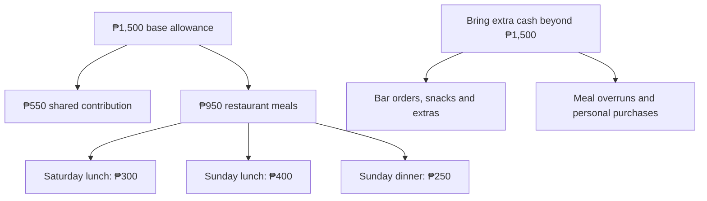
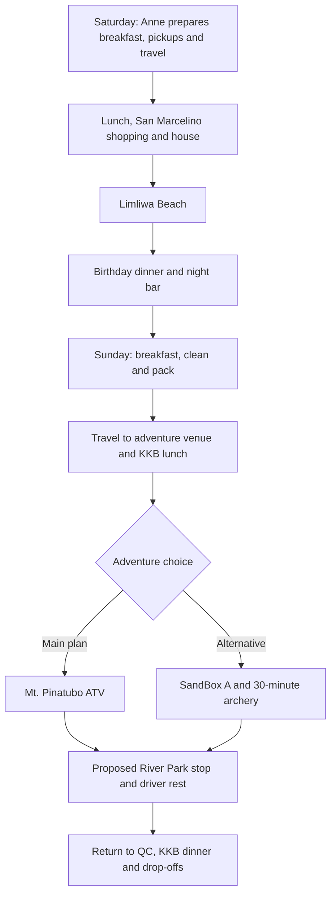

# Birthday Trip · November 7-8, 2026

**Zambales · Beach Saturday · Adventure Sunday**

A joint birthday celebration for **MC, Richelle and Paul**, with an overnight stay at Barte’s grandfather’s house in **San Antonio, Zambales**.

[Download the printable PDF](Birthday-Trip-Plan.pdf) · [PNG overview](assets/trip-overview.png)

| Detail | Current plan |
| --- | --- |
| Dates | Saturday-Sunday, November 7-8, 2026 |
| Transport | Barte’s car; final seating and driver to be confirmed |
| Meetup | Pickups along the route, then Luzon meetup point |
| Accommodation | Family home in San Antonio |
| Saturday | Lunch, groceries, Limliwa Beach, birthday dinner and night bar |
| Sunday | ATV adventure and a relaxing park stop |
| Personal budget | **₱1,500 base allowance - please bring extra cash** |
| Target home arrival | Around **11 PM Sunday**, depending on traffic |

**The itinerary is still proposed. Pending destinations and arrangements are open to group suggestions and approval.**

## Route maps

| Day | Google Maps route |
| --- | --- |
| Day 1 - Saturday, November 7 | [Open route](https://maps.app.goo.gl/bow4Z7npJpLcuBze9) |
| Day 2 - Sunday, November 8 | [Open route](https://maps.app.goo.gl/9TENoR7mgRZXrqK6A) |

Group route links supplied by MC. Sunday’s final route and timings remain subject to the confirmed ATV operator or SandBox alternative.

## Personal budget and KKB expenses

| Expense per friend | Suggested amount |
| --- | --- |
| Shared contribution toward groceries, fuel and tolls | ₱550 |
| Saturday lunch outside | ₱300 |
| Sunday lunch outside | ₱400 |
| Sunday dinner outside | ₱250 |
| **Base allowance** | **₱1,500** |

**Please bring extra cash on top of ₱1,500.** The meal amounts are estimates, and ₱1,500 is **not a guaranteed all-in budget**. Your actual spending will depend on restaurant prices and personal orders.

Keep **₱950 for the three restaurant meals** and set aside **₱550 for the shared contribution**.

| Additional personal expense | Arrangement |
| --- | --- |
| Night bar | **KKB** drinks, food and any applicable cover charge |
| Meals exceeding the allowance | Pay the difference individually |
| Extra snacks, drinks and personal purchases | Own expense |
| Optional activities outside the agreed itinerary | Confirm the cost and payment arrangement before joining |

## Attendance

These are the **last recorded attendance statuses**. Please reconfirm availability for the updated Zambales plan.

| Person | Status | Notes |
| --- | --- | --- |
| MC | Confirmed |  |
| Richelle | Confirmed |  |
| Karl | Confirmed |  |
| Ian Barte | Confirmed |  |
| Ian Carl | Confirmed |  |
| Paul | Pending | Expects to know around October 25 |
| Jannelle | Pending | Awaiting confirmation |
| Ian Carreon | Pending | Awaiting confirmation |
| Walter | Pending | Awaiting confirmation |
| Gerard | Pending | Awaiting confirmation |
| Blessy | Conditional | Previously day trip only; permission and transport need reconfirmation |
| Barte’s father | Tentative | May drive and prepare pork adobo if joining |
| Barte’s mother | Tentative | Awaiting confirmation |

**Current working headcount: seven**, including Barte’s parents if they join. Vehicle seating and sleeping arrangements must be reviewed if more people confirm.

## Saturday · November 7

**Beach, birthday dinner and night bar**

| Time | Plan |
| --- | --- |
| 5:30&#8209;6&nbsp;AM | MC arrives at Barte’s house, parks his motorcycle and helps load the car. |
| 6&#8209;7&nbsp;AM | Pick up Karl and Ian Carl along the route, then meet the remaining passengers at the **Luzon meetup point**. Exact pickup pins to follow. **Anne prepares a light breakfast**, such as bread with spread or filling, for the meetup / departure. Final ingredients and quantity to confirm. |
| 7&#8209;11&nbsp;AM | Travel to San Antonio, Zambales. Allow approximately **four hours**, including a short stop if needed. |
| 11&nbsp;AM&#8209;12&nbsp;NN | **Lunch outside - KKB.** Choose a restaurant along the route or near San Antonio. |
| 12&#8209;1:30&nbsp;PM | Shop at **San Marcelino Public Market**, then a grocery for missing items. Buy dinner and breakfast ingredients, fruit, cake, snacks, drinks, water and ice. Allow 60-90 minutes; Karl identifies the breakfast ingredients. |
| 1:30&#8209;2&nbsp;PM | Arrive at the house, unload and refrigerate food. Everyone prepares beach bags while the driver rests. |
| 2&#8209;2:30&nbsp;PM | Travel to **Limliwa Beach Resort**. |
| 2:30&#8209;5:30&nbsp;PM | Beach swimming, photos, games and group hangout. Cottage availability depends on walk-in occupancy. |
| 5:30&#8209;6&nbsp;PM | Leave the resort and return to the house. |
| 6&#8209;8&nbsp;PM | Shower, prepare dinner, eat together and celebrate with birthday cake. |
| 8&#8209;8:30&nbsp;PM | Travel to the selected night bar. **Venue pending.** |
| 8:30&#8209;11&nbsp;PM | Night bar and hangout. **KKB orders and any applicable cover charge.** |
| 11&#8209;11:30&nbsp;PM | Return to the house. |
| 11:30&nbsp;PM&nbsp;onward | Games, bonding or rest. No fixed group bedtime, but the driver needs sufficient sleep before Sunday’s trip. |

### Limliwa Beach reminders

**Day tour: 6 AM-6 PM only.** Walk-ins are first come, first served. **Tent pitching is prohibited**, loud speakers are discouraged, and cooking/grilling is allowed only in the common cooking area.

Dinner is planned **at the house**. Bring only what is needed for the beach.

## Sunday · November 8

**ATV adventure and a relaxed stop before heading home**

This schedule assumes an ATV provider around **Capas/Santa Juliana**. Travel times and the afternoon schedule will be adjusted once the operator and meeting point are confirmed.

| Time | Plan |
| --- | --- |
| 7:30&#8209;9&nbsp;AM | Breakfast, cleanup and packing. **Karl plans the menu and ingredients; Karl and MC cook.** Everyone helps clean and loads all belongings into the car. |
| 9&nbsp;AM&#8209;12&nbsp;NN | Travel directly to the **ATV meeting point**. Allow approximately **three hours** for now; the exact operator and location still need confirmation. |
| 12&#8209;1&nbsp;PM | **Lunch outside - KKB.** Choose a restaurant near the confirmed ATV meeting point; venue pending. |
| 1&#8209;2:30&nbsp;PM | **Mt. Pinatubo lahar-trail ATV adventure.** Allow for registration, briefing and the preferred **30-minute to one-hour ride**. Operator and booking pending. |
| 2:30&#8209;3&nbsp;PM | Change clothes if needed, freshen up and travel toward **New Clark City River Park**. Timing depends on the ATV location. |
| 3&#8209;5&nbsp;PM | Relaxed walking, photos, greenery and bonding. **Driver rests before the drive home.** Park access and route suitability remain pending. |
| 5&#8209;5:30&nbsp;PM | Restroom stop, organize belongings and prepare for departure. |
| 5:30&#8209;9:30&nbsp;PM | Travel back to QC, allowing approximately **four hours** with a rest stop if needed. |
| 9:30&#8209;10:15&nbsp;PM | **Dinner outside - KKB.** Restaurant to be decided in QC or along the return route. |
| 10:15&#8209;11&nbsp;PM | Passenger drop-offs and MC’s motorcycle pickup at Barte’s house. |
| Around&nbsp;11&nbsp;PM | Target arrival home, depending on traffic and drop-off locations. |

**There is no planned return to the San Antonio house on Sunday.** Pack everything and clean the house before leaving in the morning.

### Sunday activity choices

| Priority | Activity | Status |
| --- | --- | --- |
| **Main adventure** | **Mt. Pinatubo lahar-trail ATV** | Operator, current package, meeting point and booking pending |
| **Alternative to ATV** | **SandBox Package A + 30-minute unlimited-arrow archery** | Subject to group approval and availability |
| Relaxation | New Clark City River Park | Access and route suitability pending |

**SandBox replaces ATV if selected.** It is not an additional scheduled activity, and choosing it will require changes to the route and times.

Suggestions for a replacement adventure or relaxation stop are welcome. Choose places that fit the route and leave enough time for driver rest and the trip home.

## Shopping plan

Plan for **San Marcelino Public Market plus a short grocery stop**, rather than expecting one stall to have everything. Quantities are suggestions for seven people, not confirmed purchases. **Karl finalizes Sunday breakfast; the additional dinner dish is still pending.**

### Buy in San Marcelino / nearby

| Buy locally | Suggested quantity for 7 | Where / note |
| --- | --- | --- |
| Pork for adobo | Around 1-1.5 kg | Market meat stall; Barte’s father chooses the cut and amount |
| Additional dinner dish | Pending | Finalize the dish and volunteer before shopping |
| Rice | Around 2 kg uncooked | For dinner and breakfast; check house supplies first |
| Eggs | 10-14 pieces | Karl finalizes the breakfast list |
| Hotdogs OR longganisa | Around 750 g-1 kg | Frozen-food stall or grocery; Karl selects one based on the menu |
| Watermelon and bananas | 1 small watermelon + 10-14 bananas | Shared fruit; replace watermelon with pineapple or papaya if needed |
| Drinking water | Start with 20 litres | Refilling station or grocery; refill if needed |
| Soft drinks / juice | 2 large bottles initially | Grocery; adjust to preferences |
| Ice | Depends on cooler size | Confirm a supplier; replenish near the house |
| Birthday cake | 1 sharing cake | Arrange a bakery preorder and pickup ahead of time |
| Charcoal | Depends on grill and menu | Confirm grill availability first |

### Buy in QC and bring

| Buy in QC and bring | Plan |
| --- | --- |
| Saturday breakfast ingredients | Anne arranges bread and spread / filling before departure; final quantities to confirm |
| Marinated pork BBQ | 30 sticks; transport in a cooler with ice and refrigerate at the house |
| Sauces and seasonings | Soy sauce, vinegar, oil, salt, pepper and ingredients requested by the cooks |
| Garlic, onions and calamansi | Buy ahead if convenient; quantity depends on the final dishes |
| Chips / snacks | Buy ahead to shorten the local shopping stop |
| Shared supplies | MC brings the supplies in the gear table below |

Listings show **Mc Mar Frozen Foods inside the public market** and **Rodriguez Supermart on Agpalo Street** as a grocery backup. Exact stock, brands, prices and ice availability are unconfirmed. Ask Barte where the family buys water and ice, and arrange the cake before the trip.

**Shopping flow:** Lunch outside → San Marcelino market → grocery for missing items → water / ice pickup → house and refrigerator → beach. Allow **60-90 minutes** for shopping. Check rice, oil, seasonings, refrigerator space and grill availability at the house first.

Shopping references: [Mc Mar Frozen Foods listing](https://www.bizippines.com/mc-mar-frozen-foods-0929-565-7091) · [Rodriguez Supermart listing](https://www.cybo.com/PH-biz/rodriguez-supermart). These are store listings, not live inventory.

## Meals and cooking assignments

| Meal / task | Plan | Assigned person |
| --- | --- | --- |
| Saturday breakfast | Simple bread with spread or filling; final ingredients and quantity pending | **Anne prepares** |
| Saturday lunch | Restaurant | **KKB** |
| Saturday dinner: BBQ | **30 marinated pork BBQ sticks** | **At least two grilling volunteers needed** |
| Saturday dinner: adobo | Pork adobo | Barte’s father, if joining and confirmed |
| Saturday dinner: additional dish | **Still undecided** | Volunteer to suggest and prepare it |
| Saturday dinner: rice | Cook rice at the house | **Volunteer needed** |
| Birthday cake | Shared birthday celebration | Choice and pickup arrangements pending |
| Sunday breakfast | **Karl decides the menu and ingredients to buy** | **Karl and MC cook** |
| Sunday lunch | Restaurant | **KKB** |
| Sunday dinner | Restaurant in QC or along the return route | **KKB** |
| Preparation and cleanup | Help before and after meals | Everyone |

## Who will bring what

| Person | Items | Notes |
| --- | --- | --- |
| **Anne** | Camera gimbal, phone gimbal and picnic mat; simple Saturday breakfast | Assigned to bring and prepare; breakfast ingredients and quantity to confirm |
| **Karl** | Speaker; tent if permitted | Tent cannot be pitched at Limliwa; keep speaker use considerate |
| **Paul** | Cooler | If joining; otherwise arrange a backup |
| **MC** | Picnic mat, first-aid kit, paper plates, spoons and forks, cups, trash bags, tissue/paper towels, aluminum foil and food-safe containers with lids; 1 lighter (long-neck preferred), dishwashing liquid (200-250 mL), 1-2 dishwashing sponges and 1-2 clean kitchen/microfiber cloths | Assigned to bring; microfiber cloths for wiping counters. Keep a separate clean cloth if drying dishes. |
| **Volunteers** | UNO, playing cards or other small games | Let the group know what you can bring |

Chargers, cables and charged power banks are each person’s responsibility.

## Pending decisions and volunteers

| Item | What still needs arranging |
| --- | --- |
| **Attendance and transport** | Confirm pending attendees, Barte’s parents, driver, vehicle seating and pickup pins |
| **ATV - Sunday’s main activity** | Find a reliable operator and confirm the package, duration, meeting point, regular-car access and booking |
| **SandBox - ATV alternative** | Group approval for **Package A + 30-minute unlimited-arrow archery**; confirm availability and adjust the route if selected |
| **Saturday lunch - KKB** | Choose a restaurant along the route or near San Marcelino / San Antonio before shopping; confirm menu and prices. |
| **Sunday lunch - KKB** | Choose a restaurant near the final adventure venue; location depends on the ATV operator or SandBox selection. |
| **New Clark City River Park** | Confirm access and route suitability; alternative places to relax after the adventure are welcome |
| **Night bar** | Choose a venue and check opening hours and any cover charge |
| **Dinner volunteers** | Assign at least two BBQ grillers, a rice cook, and someone to suggest and prepare the additional dish |
| **Kitchen and grilling equipment** | Ask Barte about the stove and LPG, pots, frying pan, rice cooker, knives, chopping board, serving trays, grill and BBQ tongs. MC brings the lighter and dishwashing supplies. |
| **Refrigerator and cooler** | Confirm refrigerator space and a backup cooler if Paul cannot join |
| **Sleeping arrangements** | Confirm mattresses, pillows and blankets |
| **Water, ice and cooking basics** | Buy water and ice in Zambales; arrange charcoal, sauces, seasonings and other ingredients |
| **Games and extension cord** | Ask who can bring small games; check whether an extension cord is available at the house |
| **Shopping and cake** | Confirm the third dish and Karl’s breakfast list; check house supplies, local hotdog / longganisa stock, water and ice sources, and cake preorder / pickup. |
| **Saturday breakfast** | Anne prepares a light breakfast for departure; confirm the bread, filling, quantity and ingredient / cost arrangements. |

## Personal packing checklist

| Category | Bring |
| --- | --- |
| **Clothes** | Swimwear, dry outfit after the beach, sleepwear, Sunday adventure outfit, spare clothes, underwear and socks |
| **Footwear** | Closed-toe shoes for adventure activities; slippers for the beach and house |
| **Beach essentials** | Towel, sunscreen, waterproof pouch and wet-clothing bag |
| **Personal care** | Toiletries, personal medication, insect repellent and hygiene essentials |
| **Electronics** | Phone, charger, cable and charged power bank |
| **Travel essentials** | ID, cash, refillable water bottle, overnight bag and small day bag |
| **Rain protection** | Compact umbrella or raincoat |
| **Optional comfort items** | Cap, light jacket, personal snacks and small pillow |

**Bring extra cash beyond the ₱1,500 base allowance**, particularly for night-bar orders, extra snacks and meals that exceed the estimates.

The designated driver should remain sober and get sufficient rest. The schedule may change with weather, traffic, availability and the group’s condition.
