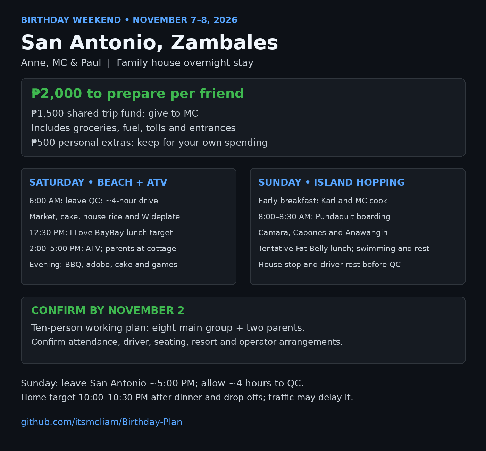
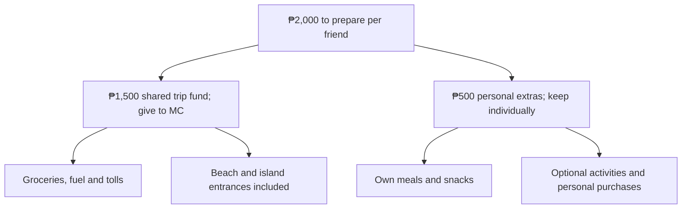
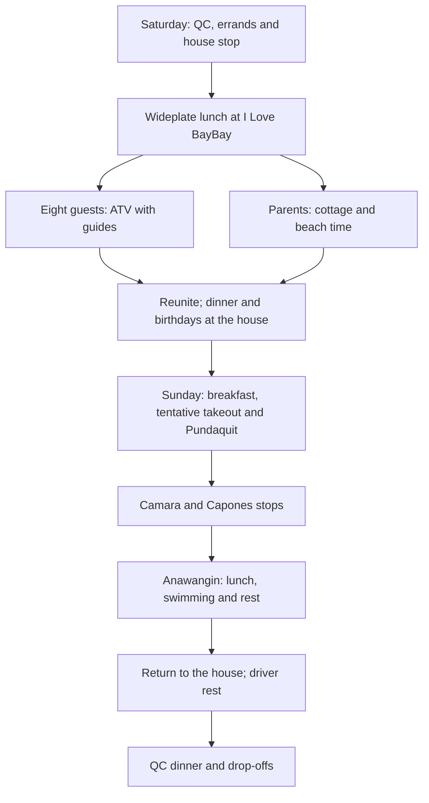

# San Antonio, Zambales — Birthday Trip

**November 7–8, 2026 · Birthdays of Anne, MC and Paul**

Updated October 27, 2026. Working plan: eight main-group participants plus Barte’s two parents.

[Full printable plan](Birthday-Trip-Plan.pdf) · [Parents’ PDF](Birthday-Trip-Parents-Guide.pdf) · [Three parents’ images](assets/parents/README.md)

## Trip at a glance

| Detail | Current plan |
| --- | --- |
| Celebration | Birthdays of Anne, MC and Paul • November 7–8, 2026 |
| Stay | Barte’s grandfather’s house in San Antonio, Zambales |
| Working headcount | Eight in the main group, including MC, plus Barte’s two parents: ten total. Final attendance is pending. |
| Meetup / departure | Jollibee Soliven, tentative. Meet 5:30 AM; leave QC by 6:00 AM. MC coordinates motorcycle parking at Barte’s beforehand. |
| Transport | Planned driver: Barte’s father, subject to confirmation. Confirm vehicle count, safe seating for ten and all driver arrangements. |
| Saturday | Errands, Wideplate takeout, I Love BayBay, Liwliwa ATV Getaways, birthday dinner at the house |
| Sunday | Jessilyn private island hopping: Camara, Capones and Anawangin; return to the house, then QC |
| Return | Leave San Antonio around 5:00 PM; target home 10:00–10:30 PM, depending on traffic, dinner and drop-offs. |

## Your personal budget

| Allocation per friend | Amount |
| --- | --- |
| Shared trip fund — give to MC; includes groceries, fuel, tolls and entrances | ₱1,500 |
| Personal extras — keep individually | ₱500 |
| Total to prepare | ₱2,000 |

Prepare ₱2,000 per friend: give ₱1,500 to MC for the shared trip fund and keep ₱500 for personal extras, including your own meals, snacks, optional activities or purchases. Entrances are already included in the shared fund; there is no separate entrance collection. Personal spending beyond ₱500 is your own responsibility. I Love BayBay’s remaining inclusions and any separate charges still need confirmation.

The plan includes shared Saturday lunch, dinner, Sunday breakfast and island lunch, plus the arranged main ATV and boat activities. No additional collection is currently planned for those scheduled activities. Optional activities, rentals, extra food/drinks and personal purchases are KKB; check the price before joining.

## Saturday — November 7

| Time | Saturday, November 7 |
| --- | --- |
| 5:30–6:00 AM | Meet and load at Jollibee Soliven (tentative). IanCarl prepares and packs the light breakfast. Coordinate MC’s motorcycle parking before departure. |
| 6:00–10:00 AM | Travel to Zambales. Allow about four hours, with a short rest stop if needed. |
| 10:00–11:00 AM | One-hour San Marcelino market / grocery stop. Buy the remaining dinner, breakfast and rice ingredients, fruit, drinking water, ice and charcoal. |
| 11:00 AM–12:00 NN | KDB Sweet Shop cake pickup and preordered Wideplate ulam pickup. House stop: cook lunch rice, refrigerate meat and cake, unload and prepare beach bags. Divide tasks; this is a tight target. |
| 12:00–12:30 PM | Travel to I Love BayBay. Target arrival 12:30 PM; outside-food permission and the day-use arrangements need a clear reply. |
| 12:30–1:30 PM | Lunch at the open cottage: Wideplate ulam with house-cooked rice, then bonding and photos. Coordinate the seafood allergy with the restaurant. |
| 1:30–2:00 PM | Prepare for ATV, meet the guides and attend the safety briefing. Barte’s parents remain at the beach cottage. Pickup point still needs confirmation. |
| 2:00–5:00 PM | Eight guests ride four ATVs with a separate guide/emergency unit. Package includes waterfalls, coastal and beach trails, carabao ride, trekking, about one hour at the falls and drone shots. Guide must arrange upper-falls access before its 4:00 PM cutoff. |
| 5:00–6:00 PM | Reunite with the parents, wash up and collect belongings. Confirm resort showers and allowed day-tour hours. |
| 6:00–8:00 PM | Return to the house, cook pork BBQ, pork adobo and rice, then eat together. |
| 8:00 PM onward | Birthday cake for Anne, MC and Paul; games, music, photos and bonding at the house. Prepare Sunday’s bags. The driver needs sufficient rest. |

All times are targets, not bookings or guaranteed travel times. Preorder food and cake and divide the house tasks to reach the beach by 12:30 PM. If errands run late, shorten the initial beach hangout while preserving the 2:00 PM ATV start. Boat stops and timing depend on the operator and sea conditions.

## Sunday — November 8

| Time | Sunday, November 8 |
| --- | --- |
| 5:30–7:00 AM | Karl and MC cook sinangag, eggs and longganisa. Karl plans quantities. Cook island-lunch rice; Fat Belly Deli early takeout is tentative. |
| 7:00–7:30 AM | Eat, clean up and pack day bags, food and water. Collect Fat Belly takeout only if early pickup is confirmed; organize overnight bags for the house return. |
| 7:30–8:00 AM | Travel to the boat meeting point. Allow about 15 minutes from Jollibee San Antonio, plus time from the house and boarding buffer. Use Jessilyn’s supplied Pundaquit map pin; confirm the boarding meeting spot and parking charge. |
| 8:00–8:30 AM | Meet Jessilyn’s operator, load food and bags, and prepare life jackets. Confirm the stop order and return pickup. |
| 8:30–10:30 AM | Boat travel and Camara / Capones sightseeing and photo stops. This order and timing are proposed, subject to the operator and sea conditions. |
| 10:30 AM–12:00 NN | Reach Anawangin, settle at an open table/cottage, swim and relax. Table reservation and CR/shower inclusions still need confirmation. |
| 12:00–1:00 PM | Shared lunch: tentative Fat Belly Deli takeout with house-cooked rice. Daily specials, portions and early pickup await confirmation. Eat earlier if needed. |
| 1:00–2:30 PM | Relaxed Anawangin time: swimming, photos, volleyball, cards and picnic-mat bonding. Available optional water activities and purchases are KKB. |
| 2:30–3:30 PM | Wash up, pack and return by boat to Pundaquit. Agree on this pickup with Jessilyn; it is not yet a confirmed timetable. |
| 3:30–5:00 PM | Return to the house, collect bags and finish cleanup. Driver rests or naps while everyone else packs. |
| 5:00–9:00 PM | Travel back to QC. Allow about four hours and stop if the driver needs a break. |
| 9:00–9:30 PM | Fast-food dinner in QC: KKB. Choose a convenient place on arrival. |
| 9:30–10:30 PM | Passenger drop-offs and MC’s motorcycle pickup. Target everyone home around 10:00–10:30 PM; traffic can delay arrival. |

Return to the San Antonio house for bags and driver rest before the QC journey.

## Attendance — finalize by November 2

| Person | Status | Notes |
| --- | --- | --- |
| MC / Anne / Karl / Ian Barte / IanCarl | Confirmed | Five named confirmations so far |
| Paul / Jannelle / Ian Carreon | Pending | Reconfirm by November 2 |
| Blessy | Pending | Mother approved; father’s permission still pending |
| Barte’s parents | Planned, not final | Confirm both parents and driver arrangements |
| Working total | Ten | Eight main-group participants plus two parents; final names may change |

The working headcount is not ten confirmed people. Please confirm by **November 2**.

## Pending decisions and volunteers

| Item | What still needs a decision or clear confirmation |
| --- | --- |
| Attendance / transport | Complete the named list by November 2; confirm parents, driver, seating and pickup arrangement. |
| I Love BayBay | Free open cottage quoted. Confirm outside food/drinks, cooler, corkage, hours, showers, parking and extra fees. Hello Beach is backup only; quoted cottage, griller and no corkage. |
| ATV Getaways | Selected package and 2:00 PM target. Confirm booking, pickup at I Love BayBay, parking, rider arrangements and weather policy. |
| Jessilyn island hopping | Selected route: Anawangin, Capones and Camara. Confirm headcount, boarding spot at the supplied map pin, table, stop duration/order, return pickup, CR/showers, corkage and any parking/environmental fees. |
| Saturday lunch | Five Wideplate dishes selected. Confirm portions for ten, lumpia quantity, allergy arrangements and pickup. Containers are free; bangus is whole and boneless. |
| Sunday lunch | Fat Belly Deli is tentative. Await updated menu, early Sunday takeout and portions for ten. Choose dishes after the daily specials are known; arrange safe food transport. |
| Cake | KDB Sweet Shop pickup after groceries; confirm final flavor/design and pickup time. |
| Dinner / rice volunteers | Confirm adobo cook; at least two BBQ grillers; assign rice cooking and general preparation. |
| Shared gear / games | Borrow the main cooler; arrange a backup if Paul cannot join. Assign sunscreen, lighter, dishwashing supplies, shuttlecocks and games. |

Suggestions are welcome for unresolved arrangements; coordinate changes with the group before booking.

## Shared items to pack

| Already available — MC | Still to arrange / pack |
| --- | --- |
| ☑ Two soft-drink bottles | ☐ Main cooler — MC to borrow |
| ☑ Picnic mat; first-aid kit | ☐ Additional cooler — Paul if joining |
| ☑ Paper plates; spoons and forks; cups | ☐ Shared sunscreen — volunteer |
| ☑ Trash bags; tissue / paper towels | ☐ Lighter — volunteer |
| ☑ Aluminum foil; food-safe lidded containers | ☐ Dishwashing liquid, 200–250 mL; 1–2 sponges — volunteer |
| ☑ Clean kitchen / microfiber cloths | ☐ UNO, playing cards or mini Jenga — volunteers |
| ☑ Separate wiping and dish-drying cloths | ☐ Shuttlecocks — volunteer |
| ☑ Three food trays | ☐ Suitable hot/cold storage for island lunch |

☑ Already available; still pack and check quantities. ☐ To buy, borrow, assign or prepare.

## Assigned preparation — three columns

| Anne | Karl | IanCarl |
| --- | --- | --- |
| ☐ Camera and phone gimbals | ☐ Finalize Sunday breakfast menu / quantities | ☐ Prepare and pack Saturday light breakfast |
| ☐ Picnic mat | ☐ List / coordinate breakfast ingredients | ☐ Badminton rackets |
| ☐ Confirm volleyball to bring | ☐ Speaker, subject to venue permission | ☐ Dishwashing |
| ☐ Check longganisa purchase with Mom and Karl | ☐ Tent only if useful and permitted | Rackets available; shuttlecocks still needed |

## Shopping checklist

| Buy in QC / bring | Buy in Zambales / pick up |
| --- | --- |
| ☐ 30 marinated pork BBQ sticks; keep iced | ☐ Pork for adobo — around 2 kg, cook to confirm |
| ☐ Cooking oil, soy sauce and vinegar | ☐ Rice — around 4–5 kg for four rice meals |
| ☐ Salt, peppercorns and a small pack of laurel | ☐ Eggs and longganisa — Karl finalizes; check Anne’s purchase |
| ☐ Garlic, onions and calamansi | ☐ Bananas and one small watermelon |
| ☐ Iced-tea sachets, if wanted | ☐ Drinking water — start with 20 L; replenish as needed |
| ☐ Sharing chips, around four bags; one cracker / biscuit multipack | ☐ Ice and charcoal |
| ☐ One Mentos pack | ☐ KDB Sweet Shop cake pickup after groceries |
| ☐ Saturday breakfast supplies — IanCarl | ☐ Wideplate takeout ulam pickup |
| Check sauce / seasoning quantities with cooks | ☐ Sunday takeout once confirmed; Fat Belly Deli tentative |

Quantities are suggestions for ten; check with the cooks before shopping. Bring our own ingredients and seasonings.

## Meals and cooking volunteers

| Meal / task | Plan / assignment |
| --- | --- |
| Saturday light breakfast | IanCarl prepares and packs it. |
| Saturday lunch | Bistek Tagalog, Crispy Pork Sisig, Classic Garlic Bangus, Pinakbet with Lechon Kawali and Pork Lumpia; house rice. Portions and allergy arrangements pending. |
| Saturday dinner | 30 pork BBQ sticks + pork adobo + rice. No third dish. Barte’s father for adobo, subject to confirmation; two BBQ grillers and rice cook needed. |
| Sunday breakfast | Karl plans sinangag, eggs and longganisa. Karl and MC cook. |
| Sunday lunch | Tentative Fat Belly Deli takeout + house-cooked rice. Menu, serving sizes and early pickup pending; keep the rice cooker at the house. |
| Sunday dinner | KKB fast-food meal in QC. |
| Cleanup | IanCarl handles dishwashing; everyone helps with preparation, packing and cleanup. |

Carry raw meat in sealed leakproof containers with ice, then refrigerate it promptly at the house. Prefer a separate clean drinks cooler. If reusing the meat cooler, empty, clean and sanitize it before adding fresh ice and ready-to-eat items. Keep the island lunch appropriately hot or chilled during transport. Serving trays alone do not control food temperature; leave the rice cooker at the house.

## Personal packing

| Pack for yourself | Details |
| --- | --- |
| Clothes | Swimwear for two days, dry changes, sleepwear, underwear and a spare home-going outfit. |
| Adventure gear | Closed-toe shoes, comfortable clothes, towel and a waterproof / day bag. |
| House / beach gear | Slippers, toiletries, usual medication, sun protection and insect repellent. |
| Essentials | ID, cash, phone, charger, charged power bank and refillable water bottle. |
| Keep things separate | Wet-clothes bags and leakproof food containers; bring rain protection. |

## Routes and venue links

| Venue / route | Google Maps | Facebook |
| --- | --- | --- |
| Saturday driving route | [Open map](https://maps.app.goo.gl/VXTT4ugm6bqVBXMD8) | — |
| Sunday driving route | [Open map](https://maps.app.goo.gl/XKAea3D4XjEApZs69) | — |
| I Love BayBay | [Open map](https://maps.app.goo.gl/rCENhvGy7jd94VB37) | [Facebook](https://www.facebook.com/profile.php?id=100077308951284) |
| Liwliwa ATV Getaways | [Open map](https://maps.app.goo.gl/s4er5kgtLcWiRMV8A) | [Facebook](https://www.facebook.com/profile.php?id=61559843702364) |
| Jessilyn Travel and Tours | [Open map](https://maps.app.goo.gl/vAVGLiaypsbTfios8) | [Facebook](https://www.facebook.com/profile.php?id=100083507706578) |
| KDB Sweet Shop | [Open map](https://maps.app.goo.gl/ZW9u7sivSZY92D2J9) | [Facebook](https://www.facebook.com/KDBSweetShop/) |
| Wideplate | [Open map](https://maps.app.goo.gl/J9N4yDfm3ZjHLgPx8) | [Facebook](https://www.facebook.com/wideplaterestaurant/) |
| Fat Belly Deli (tentative) | [Open map](https://maps.app.goo.gl/aYWhckyfEJmvZSQB6) | [Facebook](https://www.facebook.com/fatbellykfarmdeli) |

Latest routes supplied by MC. Jollibee San Antonio is the public reference for the nearby family house; share its private pin directly. The route links show the main driving stops; allow time for grocery, cake and food pickups. Jessilyn’s supplied pin points to Ariño Parking w/ Pay in Pundaquit: reconfirm the boarding meeting spot and parking charge with the operator.

## Budget allocation

## Trip flow

The selected ATV and boat plans are not represented as paid reservations. Venue policies, availability, weather and driver readiness may change the schedule.
