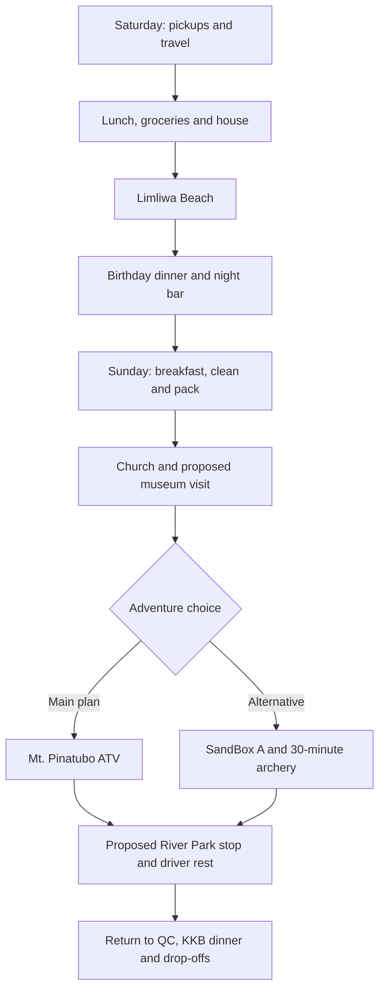

# Birthday Trip · November 7-8, 2026

**Zambales · Beach Saturday · Adventure Sunday**

A joint birthday celebration for **MC, Richelle and Paul**, with an overnight stay at Barte’s grandfather’s house in **San Antonio, Zambales**.

[Download the printable PDF](Birthday-Trip-Plan.pdf) · [PNG overview](assets/trip-overview.png)

| Detail | Current plan |
| --- | --- |
| Dates | Saturday-Sunday, November 7-8, 2026 |
| Transport | Barte’s car; final seating and driver to be confirmed |
| Meetup | Pickups along the route, then Luzon meetup point |
| Accommodation | Family home in San Antonio |
| Saturday | Lunch, groceries, Limliwa Beach, birthday dinner and night bar |
| Sunday | Church, museum, ATV adventure and a relaxing park stop |
| Personal budget | **₱1,500 base allowance - please bring extra cash** |
| Target home arrival | Around **11 PM Sunday**, depending on traffic |

**The itinerary is still proposed. Pending destinations and arrangements are open to group suggestions and approval.**

## Personal budget and KKB expenses

| Expense per friend | Suggested amount |
| --- | --- |
| Shared contribution toward groceries, fuel and tolls | ₱550 |
| Saturday lunch outside | ₱300 |
| Sunday lunch outside | ₱400 |
| Sunday dinner outside | ₱250 |
| **Base allowance** | **₱1,500** |

**Please bring extra cash on top of ₱1,500.** The meal amounts are estimates, and ₱1,500 is **not a guaranteed all-in budget**. Your actual spending will depend on restaurant prices and personal orders.

Keep **₱950 for the three restaurant meals** and set aside **₱550 for the shared contribution**.

| Additional personal expense | Arrangement |
| --- | --- |
| Saturday breakfast | Buy or eat your own breakfast before departure |
| Night bar | **KKB** drinks, food and any applicable cover charge |
| Meals exceeding the allowance | Pay the difference individually |
| Extra snacks, drinks and personal purchases | Own expense |
| Optional activities outside the agreed itinerary | Confirm the cost and payment arrangement before joining |

## Attendance

These are the **last recorded attendance statuses**. Please reconfirm availability for the updated Zambales plan.

| Person | Status | Notes |
| --- | --- | --- |
| MC | Confirmed |  |
| Richelle | Confirmed |  |
| Karl | Confirmed |  |
| Ian Barte | Confirmed |  |
| Ian Carl | Confirmed |  |
| Paul | Pending | Expects to know around October 25 |
| Jannelle | Pending | Awaiting confirmation |
| Ian Carreon | Pending | Awaiting confirmation |
| Walter | Pending | Awaiting confirmation |
| Gerard | Pending | Awaiting confirmation |
| Blessy | Conditional | Previously day trip only; permission and transport need reconfirmation |
| Barte’s father | Tentative | May drive and prepare pork adobo if joining |
| Barte’s mother | Tentative | Awaiting confirmation |

**Current working headcount: seven**, including Barte’s parents if they join. Vehicle seating and sleeping arrangements must be reviewed if more people confirm.

## Saturday · November 7

**Beach, birthday dinner and night bar**

| Time | Plan |
| --- | --- |
| 5:30-6:00 AM | MC arrives at Barte’s house, parks his motorcycle and helps load the car. |
| 6:00-7:00 AM | Pick up Karl and Ian Carl along the route, then meet the remaining passengers at the **Luzon meetup point**. Exact pickup pins to follow. Have your own breakfast beforehand or bring something ready to eat. |
| 7:00-11:00 AM | Travel to San Antonio, Zambales. Allow approximately **four hours**, including a short stop if needed. |
| 11:00 AM-12:00 NN | **Lunch outside - KKB.** Choose a restaurant along the route or near San Antonio. |
| 12:00-1:00 PM | Market and grocery run for dinner, Sunday breakfast, birthday cake, snacks, drinks, water and ice. Karl will identify the breakfast ingredients needed. |
| 1:00-2:00 PM | Arrive at the house, unload and refrigerate food. Prepare beach bags while the driver rests. |
| 2:00-2:30 PM | Travel to **Limliwa Beach Resort**. |
| 2:30-5:30 PM | Beach swimming, photos, games and group hangout. Cottage availability depends on walk-in occupancy. |
| 5:30-6:00 PM | Leave the resort and return to the house. |
| 6:00-8:00 PM | Shower, prepare dinner, eat together and celebrate with birthday cake. |
| 8:00-8:30 PM | Travel to the selected night bar. **Venue pending.** |
| 8:30-11:00 PM | Night bar and hangout. **KKB orders and any applicable cover charge.** |
| 11:00-11:30 PM | Return to the house. |
| 11:30 PM onward | Games, bonding or rest. No fixed group bedtime, but the driver needs sufficient sleep before Sunday’s trip. |

### Limliwa Beach reminders

**Day tour: 6 AM-6 PM only.** Walk-ins are first come, first served. **Tent pitching is prohibited**, loud speakers are discouraged, and cooking/grilling is allowed only in the common cooking area.

Dinner is planned **at the house**. Bring only what is needed for the beach.

## Sunday · November 8

**Sightseeing, adventure and a relaxed stop before heading home**

This schedule assumes an ATV provider around **Capas/Santa Juliana**. Travel times and the afternoon schedule will be adjusted once the operator and meeting point are confirmed.

| Time | Plan |
| --- | --- |
| 7:00-8:00 AM | **Breakfast planned by Karl and cooked by Karl and MC.** Everyone eats, helps clean the house and loads all belongings into the car. |
| 8:00-8:30 AM | Short visit to **Holy Infant Jesus Parish, San Antonio**, subject to services and visitor access. |
| 8:30-9:00 AM | Travel to **Museo ni Ramon Magsaysay in Castillejos**. |
| 9:00-10:00 AM | Museum visit. **Proposed stop:** Sunday opening and advance-booking requirements need confirmation. |
| 10:00 AM-12:30 PM | Travel toward the ATV meeting point. Timing remains provisional until the operator is selected. |
| 12:30-1:30 PM | **Lunch outside - KKB.** Restaurant to be decided. |
| 1:30-3:00 PM | **Main activity: Mt. Pinatubo lahar-trail ATV adventure.** Preferred ride duration is **30 minutes to one hour**, with additional time for registration and briefing. Operator and booking are pending. |
| 3:00-3:30 PM | Travel toward **New Clark City River Park**, depending on the final ATV location. |
| 3:30-5:00 PM | Relaxed walking, photos, greenery and bonding. Give the driver uninterrupted time to rest. **Park access and route suitability need confirmation.** |
| 5:00-5:30 PM | Restroom stop, organize belongings and prepare for the drive home. |
| 5:30-9:30 PM | Travel back to QC. Allow approximately **four hours**, including a rest stop if needed. |
| 9:30-10:15 PM | **Dinner outside - KKB.** Choose a restaurant upon arrival or along the return route. |
| 10:15-11:00 PM | Passenger drop-offs and MC’s motorcycle pickup at Barte’s house. |
| Around 11:00 PM | Target arrival home, depending on traffic and drop-off locations. |

**There is no planned return to the San Antonio house on Sunday.** Pack everything and clean the house before leaving in the morning.

### Sunday activity choices

| Priority | Activity | Status |
| --- | --- | --- |
| **Main adventure** | **Mt. Pinatubo lahar-trail ATV** | Operator, current package, meeting point and booking pending |
| **Alternative to ATV** | **SandBox Package A + 30-minute unlimited-arrow archery** | Subject to group approval and availability |
| Sightseeing | Museo ni Ramon Magsaysay | Sunday opening and reservation requirements pending |
| Relaxation | New Clark City River Park | Access and route suitability pending |

**SandBox replaces ATV if selected.** It is not an additional scheduled activity, and choosing it will require changes to the route and times.

Suggestions for replacements are welcome, especially for the museum and park. Choose places that fit the route and leave enough time for driver rest and the trip home.

## Meals and cooking assignments

| Meal / task | Plan | Assigned person |
| --- | --- | --- |
| Saturday breakfast | Own breakfast | Each person |
| Saturday lunch | Restaurant | **KKB** |
| Saturday dinner: BBQ | **30 marinated pork BBQ sticks** | **At least two grilling volunteers needed** |
| Saturday dinner: adobo | Pork adobo | Barte’s father, if joining and confirmed |
| Saturday dinner: additional dish | **Still undecided** | Volunteer to suggest and prepare it |
| Saturday dinner: rice | Cook rice at the house | **Volunteer needed** |
| Birthday cake | Shared birthday celebration | Choice and pickup arrangements pending |
| Sunday breakfast | **Karl decides the menu and ingredients to buy** | **Karl and MC cook** |
| Sunday lunch | Restaurant | **KKB** |
| Sunday dinner | Restaurant in QC or along the return route | **KKB** |
| Preparation and cleanup | Help before and after meals | Everyone |

## Who will bring what

| Person | Items | Notes |
| --- | --- | --- |
| **Anne** | Camera gimbal, phone gimbal and picnic mat | Assigned to bring |
| **Karl** | Speaker; tent if permitted | Tent cannot be pitched at Limliwa; keep speaker use considerate |
| **Paul** | Cooler | If joining; otherwise arrange a backup |
| **MC** | Picnic mat, first-aid kit, paper plates, spoons and forks, cups, trash bags, tissue/paper towels, aluminum foil and food-safe containers with lids | Assigned to bring |
| **Volunteers** | UNO, playing cards or other small games | Let the group know what you can bring |

Chargers, cables and charged power banks are each person’s responsibility.

## Pending decisions and volunteers

| Item | What still needs arranging |
| --- | --- |
| **Attendance and transport** | Confirm pending attendees, Barte’s parents, driver, vehicle seating and pickup pins |
| **ATV - Sunday’s main activity** | Find a reliable operator and confirm the package, duration, meeting point, regular-car access and booking |
| **SandBox - ATV alternative** | Group approval for **Package A + 30-minute unlimited-arrow archery**; confirm availability and adjust the route if selected |
| **Museo ni Ramon Magsaysay** | Confirm Sunday opening, advance-booking requirements and headcount; replacement suggestions welcome |
| **New Clark City River Park** | Confirm access and route suitability; alternative places to relax after the adventure are welcome |
| **Night bar** | Choose a venue and check opening hours and any cover charge |
| **Dinner volunteers** | Assign at least two BBQ grillers, a rice cook, and someone to suggest and prepare the additional dish |
| **Kitchen and grilling equipment** | Ask Barte about the stove, pans, knives, chopping board, serving trays, grill, tongs and lighter |
| **Refrigerator and cooler** | Confirm refrigerator space and a backup cooler if Paul cannot join |
| **Sleeping arrangements** | Confirm mattresses, pillows and blankets |
| **Water, ice and cooking basics** | Buy water and ice in Zambales; arrange charcoal, sauces, seasonings and other ingredients |
| **Games and extension cord** | Ask who can bring small games; check whether an extension cord is available at the house |

## Personal packing checklist

| Category | Bring |
| --- | --- |
| **Clothes** | Swimwear, dry outfit after the beach, sleepwear, Sunday adventure outfit, spare clothes, underwear and socks |
| **Footwear** | Closed-toe shoes for adventure activities; slippers for the beach and house |
| **Beach essentials** | Towel, sunscreen, waterproof pouch and wet-clothing bag |
| **Personal care** | Toiletries, personal medication, insect repellent and hygiene essentials |
| **Electronics** | Phone, charger, cable and charged power bank |
| **Travel essentials** | ID, cash, refillable water bottle, overnight bag and small day bag |
| **Rain protection** | Compact umbrella or raincoat |
| **Optional comfort items** | Cap, light jacket, personal snacks and small pillow |

**Bring extra cash beyond the ₱1,500 base allowance**, particularly for your breakfast, night-bar orders and meals that exceed the estimates.

The designated driver should remain sober and get sufficient rest. The schedule may change with weather, traffic, availability and the group’s condition.
