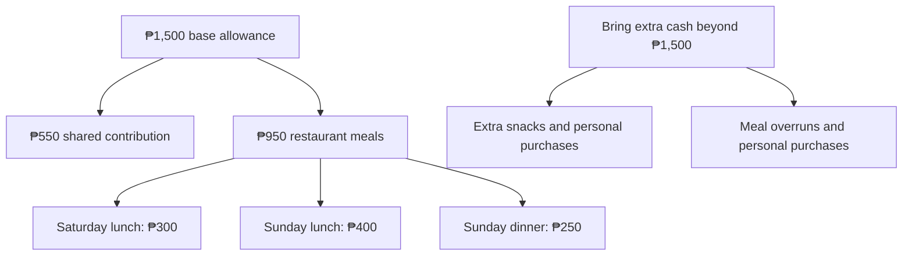

# Birthday Trip · November 7-8, 2026

**Zambales · Beach Saturday · Adventure Sunday**

A joint birthday celebration for **MC, Richelle and Paul**, with an overnight stay at Barte’s grandfather’s house in **San Antonio, Zambales**.

[Download the printable PDF](Birthday-Trip-Plan.pdf) · [PNG overview](assets/trip-overview.png)

| Detail | Current plan |
| --- | --- |
| Dates | Saturday-Sunday, November 7-8, 2026 |
| Transport | Barte’s car; final seating and driver to be confirmed |
| Meetup | Pickups along the route, then Luzon meetup point |
| Accommodation | Family home in San Antonio |
| Saturday | Lunch, groceries, Limliwa Beach, birthday dinner and games at the house |
| Sunday | ATV adventure and a relaxing park stop |
| Personal budget | **₱1,500 base allowance - please bring extra cash** |
| Target home arrival | Around **11 PM Sunday**, depending on traffic |

**The itinerary is still proposed. Pending destinations and arrangements are open to group suggestions and approval.**

## Route maps

| Day | Google Maps route |
| --- | --- |
| Day 1 - Saturday, November 7 | [Open route](https://maps.app.goo.gl/bow4Z7npJpLcuBze9) |
| Day 2 - Sunday, November 8 | [Open route](https://maps.app.goo.gl/9TENoR7mgRZXrqK6A) |

Group route links supplied by MC. Sunday’s final route and timings remain subject to the confirmed ATV operator or SandBox alternative.

## Personal budget and KKB expenses

| Expense per friend | Suggested amount |
| --- | --- |
| Shared contribution toward groceries, fuel and tolls | ₱550 |
| Saturday lunch outside | ₱300 |
| Sunday lunch outside | ₱400 |
| Sunday dinner outside | ₱250 |
| **Base allowance** | **₱1,500** |

**Please bring extra cash on top of ₱1,500.** The meal amounts are estimates, and ₱1,500 is **not a guaranteed all-in budget**. Your actual spending will depend on restaurant prices and personal orders.

Keep **₱950 for the three restaurant meals** and set aside **₱550 for the shared contribution**.

| Additional personal expense | Arrangement |
| --- | --- |
| Meals exceeding the allowance | Pay the difference individually |
| Extra snacks, drinks and personal purchases | Own expense |
| Optional activities outside the agreed itinerary | Confirm the cost and payment arrangement before joining |

## Attendance

**Final attendance deadline: November 2, 2026.** Please confirm by then so Barte can finalize the headcount and house arrangements. The table below shows the last recorded attendance statuses.

| Person | Status | Notes |
| --- | --- | --- |
| MC | Confirmed |  |
| Richelle | Confirmed |  |
| Karl | Confirmed |  |
| Ian Barte | Confirmed |  |
| Ian Carl | Confirmed |  |
| Paul | Pending | Expects to know around October 25 |
| Jannelle | Pending | Awaiting confirmation |
| Ian Carreon | Pending | Awaiting confirmation |
| Blessy | Conditional | Previously day trip only; permission and transport need reconfirmation |
| Barte’s father | Tentative | May drive and prepare pork adobo if joining |
| Barte’s mother | Tentative | Awaiting confirmation |

**Current working headcount: seven**, including Barte’s parents if they join. Vehicle seating and sleeping arrangements must be reviewed if more people confirm.

## Saturday · November 7

**Beach, birthday dinner and games at the house**

| Time | Plan |
| --- | --- |
| 5:30&#8209;6&nbsp;AM | MC arrives at Barte’s house, parks his motorcycle and helps load the car. |
| 6&#8209;7&nbsp;AM | Pick up Karl and Ian Carl along the route, then meet the remaining passengers at the **Luzon meetup point**. Exact pickup pins to follow. **Anne prepares a light breakfast**, such as bread with spread or filling, for the meetup / departure. **Confirmed - Anne handles breakfast preparation and arrangements.** |
| 7&#8209;11&nbsp;AM | Travel to San Antonio, Zambales. Allow approximately **four hours**, including a short stop if needed. |
| 11&nbsp;AM&#8209;12&nbsp;NN | **Lunch outside - KKB.** Choose a restaurant along the route or near San Antonio. |
| 12&#8209;1:30&nbsp;PM | Shop at **San Marcelino Public Market**, then a grocery for missing items. Buy dinner and breakfast ingredients, fruit, cake, snacks, drinks, water and ice. Allow 60-90 minutes; Karl identifies the breakfast ingredients. |
| 1:30&#8209;2&nbsp;PM | Arrive at the house, unload and refrigerate food. Everyone prepares beach bags while the driver rests. |
| 2&#8209;2:30&nbsp;PM | Travel to **Limliwa Beach Resort**. |
| 2:30&#8209;5:30&nbsp;PM | Beach swimming, photos, games and group hangout. Cottage availability depends on walk-in occupancy. |
| 5:30&#8209;6&nbsp;PM | Leave the resort and return to the house. |
| 6&#8209;8&nbsp;PM | Shower, prepare dinner, eat together and celebrate with birthday cake. |
| 8&#8209;10&nbsp;PM | Birthday games, music, group photos and bonding **at the house**. |
| 10&#8209;11:30&nbsp;PM | UNO, cards, snacks and a relaxed hangout. Volunteers can bring small games. |
| 11:30&nbsp;PM&nbsp;onward | Rest or quiet bonding. No fixed group bedtime, but the driver needs sufficient sleep before Sunday’s trip. |

### Limliwa Beach reminders

**Day tour: 6 AM-6 PM only.** Walk-ins are first come, first served. **Tent pitching is prohibited**, loud speakers are discouraged, and cooking/grilling is allowed only in the common cooking area.

Dinner is planned **at the house**. Bring only what is needed for the beach.

### Optional idea: takeout lunch and cooler flow

**Main plan: eat lunch at a restaurant before shopping and going to the beach.** An alternative is takeout lunch at Limliwa after the house stop. This is **only an idea**, pending Limliwa’s current day-tour outside-food rules, any corkage fee, and group approval. Do not change the schedule yet; takeout would mean a later lunch.

| Stage | Plan |
| --- | --- |
| QC and grocery stop | Keep marinated BBQ and other chilled ingredients in sealed, leakproof containers in an iced cooler. |
| At the house | Transfer raw meat and chilled breakfast ingredients into the refrigerator/freezer promptly. |
| Beach preparation | Prefer a separate clean cooler for drinks and chilled snacks. If reusing the meat cooler, discard old ice, wash and sanitize it, then add fresh ice. Keep chips in a dry bag. |
| If takeout is approved | Buy takeout shortly before eating at the resort, after the grocery and house stops. Confirm food and drink permission and corkage first. |

Outside-food policy reference: [Limliwa official FAQ](https://limliwabeachresort.com/about-us/). Current day-tour corkage requires direct confirmation.

## Sunday · November 8

**ATV adventure and a relaxed stop before heading home**

This schedule assumes an ATV provider around **Capas/Santa Juliana**. Travel times and the afternoon schedule will be adjusted once the operator and meeting point are confirmed.

| Time | Plan |
| --- | --- |
| 7:30&#8209;9&nbsp;AM | Breakfast, cleanup and packing. **Karl plans the menu and ingredients; Karl and MC cook.** Everyone helps clean and loads all belongings into the car. |
| 9&nbsp;AM&#8209;12&nbsp;NN | Travel directly to the **ATV meeting point**. Allow approximately **three hours** for now; the exact operator and location still need confirmation. |
| 12&#8209;1&nbsp;PM | **Lunch outside - KKB.** Choose a restaurant near the confirmed ATV meeting point; venue pending. |
| 1&#8209;2:30&nbsp;PM | **Mt. Pinatubo lahar-trail ATV adventure.** Allow for registration, briefing and the preferred **30-minute to one-hour ride**. Operator and booking pending. |
| 2:30&#8209;3&nbsp;PM | Change clothes if needed, freshen up and travel toward **New Clark City River Park**. Timing depends on the ATV location. |
| 3&#8209;5&nbsp;PM | Relaxed walking, photos, greenery and bonding. **Driver rests before the drive home.** Park access and route suitability remain pending. |
| 5&#8209;5:30&nbsp;PM | Restroom stop, organize belongings and prepare for departure. |
| 5:30&#8209;9:30&nbsp;PM | Travel back to QC, allowing approximately **four hours** with a rest stop if needed. |
| 9:30&#8209;10:15&nbsp;PM | **Dinner outside - KKB.** Restaurant to be decided in QC or along the return route. |
| 10:15&#8209;11&nbsp;PM | Passenger drop-offs and MC’s motorcycle pickup at Barte’s house. |
| Around&nbsp;11&nbsp;PM | Target arrival home, depending on traffic and drop-off locations. |

**There is no planned return to the San Antonio house on Sunday.** Pack everything and clean the house before leaving in the morning.

### Sunday activity choices

| Priority | Activity | Status |
| --- | --- | --- |
| **Main adventure** | **Mt. Pinatubo lahar-trail ATV** | Operator, current package, meeting point and booking pending |
| **Alternative to ATV** | **SandBox Package A + 30-minute unlimited-arrow archery** | Subject to group approval and availability |
| Relaxation | New Clark City River Park | Access and route suitability pending |

**SandBox replaces ATV if selected.** It is not an additional scheduled activity, and choosing it will require changes to the route and times.

Suggestions for a replacement adventure or relaxation stop are welcome. Choose places that fit the route and leave enough time for driver rest and the trip home.

## Shared checklists

**☑ Already available · ☐ Still to buy, borrow, assign or prepare.** Available items still need to be packed. Update and save the checkbox symbols as progress changes.

### Shared supplies

| Available - MC | Still to arrange |
| --- | --- |
| ☑ One bottle of soft drink | ☐ Main cooler - MC to borrow |
| ☑ Picnic mat | ☐ Additional cooler - Paul, if joining |
| ☑ First-aid kit | ☐ Shared sunscreen - volunteer |
| ☑ Paper plates | ☐ One lighter - volunteer |
| ☑ Spoons and forks | ☐ Dishwashing liquid, 200-250 mL - volunteer |
| ☑ Cups | ☐ Dishwashing sponges, 1-2 - volunteer |
| ☑ Trash bags | ☐ UNO/cards/small games - volunteers |
| ☑ Tissue/paper towels |  |
| ☑ Aluminum foil |  |
| ☑ Food-safe containers with lids |  |
| ☑ Clean kitchen/microfiber cloths |  |

### Anne and Karl

**Anne’s Saturday breakfast responsibility is confirmed.** The boxes below track preparation and packing. Karl plans Sunday breakfast, and **Karl and MC cook**.

| Anne | Karl |
| --- | --- |
| ☐ Buy Saturday breakfast ingredients | ☐ Finalize Sunday breakfast menu |
| ☐ Prepare and pack the light breakfast | ☐ List ingredients and quantities needed |
| ☐ Pack camera gimbal | ☐ Coordinate breakfast ingredient purchases |
| ☐ Pack phone gimbal | ☐ Pack speaker |
| ☐ Pack picnic mat | ☐ Tent, only if useful at a permitted location |

**Limliwa prohibits tent pitching and discourages loud speakers.**

### Shared shopping

Quantities are provisional for **7-8 people**, adjusted after the **November 2 attendance deadline**. We buy our own rice, oil, sauces and seasonings. **Anne handles Saturday breakfast separately; Karl finalizes Sunday breakfast.**

| Buy in QC | Buy in Zambales |
| --- | --- |
| ☐ **30 marinated pork BBQ sticks** | ☐ Pork for adobo, approximately **1-1.5 kg** |
| ☐ **4 sharing bags of chips**, around 100-150 g each | ☐ Ingredients for the third dish - pending |
| ☐ **1 biscuit/cracker multipack**, with 8-10 individual packs | ☐ Rice, approximately **2 kg uncooked** |
| ☐ **1 pack of Mentos** | ☐ Eggs, **10-14**, subject to Karl’s menu |
| ☐ Cooking oil | ☐ Hotdogs **or** longganisa, **750 g-1 kg**, subject to Karl’s menu |
| ☐ Soy sauce | ☐ Bananas, **10-14 pieces** |
| ☐ Vinegar | ☐ **1 small watermelon** |
| ☐ Salt and pepper | ☐ **1 sharing birthday cake** - arrange preorder/pickup |
| ☐ Garlic and onions | ☐ Drinking water, initially **20 litres** |
| ☐ Calamansi | ☐ Ice for the cooler/s |
|  | ☐ Charcoal |
|  | ☐ **1 additional soft drink**, only if needed |
|  | ☐ Iced tea sachets - optional |

Listings show **Mc Mar Frozen Foods inside the public market** and **Rodriguez Supermart on Agpalo Street** as a grocery backup. Exact stock, brands, prices and ice availability are unconfirmed. Confirm local water and ice sources, and arrange the cake before the trip.

**Shopping flow:** Lunch → San Marcelino market / grocery → water / ice pickup → house and refrigerator → beach. Allow **60-90 minutes**. We buy our own rice, cooking oil, sauces and seasonings.

Shopping references: [Mc Mar Frozen Foods listing](https://www.bizippines.com/mc-mar-frozen-foods-0929-565-7091) · [Rodriguez Supermart listing](https://www.cybo.com/PH-biz/rodriguez-supermart). These are store listings, not live inventory.

### Dinner and cooking volunteers

| Dish / task | Assignment |
| --- | --- |
| Pork BBQ | ☐ **At least two grilling volunteers needed** |
| Pork adobo | ☐ Confirm Barte’s father as cook, if joining |
| Third dish | ☐ Choose the dish and assign a cook |
| Dinner rice | ☐ Assign a cook |

Everyone helps with preparation and cleanup. The third dish remains undecided; a dish with broth is being considered.

Chargers, cables and charged power banks are each person’s responsibility.

## Pending decisions and volunteers

| Item | What still needs arranging |
| --- | --- |
| **Attendance and transport** | Finalize attendance by **November 2, 2026**; confirm Barte’s parents, driver, vehicle seating and pickup pins |
| **ATV - Sunday’s main activity** | Find a reliable operator and confirm the package, duration, meeting point, regular-car access and booking |
| **SandBox - ATV alternative** | Group approval for **Package A + 30-minute unlimited-arrow archery**; confirm availability and adjust the route if selected |
| **Saturday lunch - KKB** | Main plan: restaurant lunch before shopping. Takeout at Limliwa is an optional idea only; confirm day-tour outside-food rules, corkage and group approval before changing the schedule. |
| **Sunday lunch - KKB** | Choose a restaurant near the final adventure venue; location depends on the ATV operator or SandBox selection. |
| **New Clark City River Park** | Confirm access and route suitability; alternative places to relax after the adventure are welcome |

## Personal packing checklist

| Category | Bring |
| --- | --- |
| **Clothes** | Swimwear, dry outfit after the beach, sleepwear, Sunday adventure outfit, spare clothes, underwear and socks |
| **Footwear** | Closed-toe shoes for adventure activities; slippers for the beach and house |
| **Beach essentials** | Towel, sunscreen, waterproof pouch and wet-clothing bag |
| **Personal care** | Toiletries, personal medication, insect repellent and hygiene essentials |
| **Electronics** | Phone, charger, cable and charged power bank |
| **Travel essentials** | ID, cash, refillable water bottle, overnight bag and small day bag |
| **Rain protection** | Compact umbrella or raincoat |
| **Optional comfort items** | Cap, light jacket, personal snacks and small pillow |

**Bring extra cash beyond the ₱1,500 base allowance**, particularly for extra snacks, personal purchases and meals that exceed the estimates.

The designated driver should get sufficient sleep and take rest breaks. The schedule may change with weather, traffic, availability and the group’s condition.
