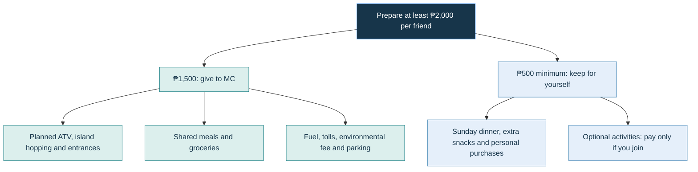

# San Antonio, Zambales — Birthday Trip

**November 7–8, 2026 · Birthdays of Anne, MC and Paul**

Updated October 27, 2026. Working target: **10 total — eight main-group participants, including MC, plus Barte’s two parents.**

## Trip at a glance

| Detail | Current plan |
| --- | --- |
| Celebration | Birthdays of Anne, MC and Paul • November 7–8, 2026 |
| Stay | Barte’s grandfather’s house in San Antonio, Zambales |
| Working headcount | Eight in the main group, including MC, plus Barte’s two parents: ten total. Final attendance is pending. |
| Meetup / departure | Jollibee Soliven, tentative. Meet 5:30 AM; leave QC by 6:00 AM. |
| Transport | Planned driver: Barte’s father, subject to confirmation. Confirm vehicle count, safe seating for ten and all driver arrangements. |
| Saturday | Errands, Wideplate takeout, I Love BayBay, Liwliwa ATV Getaways, birthday dinner at the house |
| Sunday | Jessilyn private island hopping: Camara, Capones and Anawangin; return to the house, then QC |
| Return | Leave San Antonio around 5:00 PM; target home 10:00–10:30 PM, depending on traffic, dinner and drop-offs. |

[Full printable plan](Birthday-Trip-Plan.pdf) · [Parents’ images](assets/parents/README.md)

## Your personal budget

**Bring extra cash.** The ₱1,500 covers planned activities, entrances, environmental and parking fees. Optional extras are KKB; any additional fees will be confirmed before booking.

## Saturday — November 7

| Time | Saturday, November 7 |
| --- | --- |
| 5:30–6:00 AM | Meet and load at Jollibee Soliven (tentative). IanCarl prepares and packs the light breakfast. Coordinate MC’s motorcycle parking before departure. |
| 6:00–10:00 AM | Travel to Zambales. Allow about four hours, with a short rest stop if needed. |
| 10:00–11:00 AM | One-hour San Marcelino market / grocery stop. Buy the remaining dinner, breakfast and rice ingredients, fruit, drinking water, ice and charcoal. |
| 11:00 AM–12:00 NN | KDB Sweet Shop cake pickup and preordered Wideplate ulam pickup. House stop: cook lunch rice, refrigerate meat and cake, unload and prepare beach bags. Divide tasks; this is a tight target. |
| 12:00–12:30 PM | Travel to I Love BayBay. Target arrival 12:30 PM; outside-food permission and the day-use arrangements need a clear reply. |
| 12:30–1:30 PM | Lunch at the open cottage: Wideplate ulam with house-cooked rice, then bonding and photos. Coordinate the seafood allergy. If errands run late, shorten beach bonding to keep the 2:00 PM ATV start. |
| 1:30–2:00 PM | Prepare for ATV, meet the guides and attend the safety briefing. Barte’s parents remain at the beach cottage. Pickup point still needs confirmation. |
| 2:00–5:00 PM | Eight guests ride four ATVs with a separate guide/emergency unit. Package includes waterfalls, coastal and beach trails, carabao ride, trekking, about one hour at the falls and drone shots. Guide must arrange upper-falls access before its 4:00 PM cutoff. |
| 5:00–6:00 PM | Reunite with the parents, wash up and collect belongings. Confirm resort showers and allowed day-tour hours. |
| 6:00–8:00 PM | Return to the house, cook pork BBQ, pork adobo and rice, then eat together. |
| 8:00 PM onward | Birthday cake for Anne, MC and Paul; games, music, photos and bonding at the house. Prepare Sunday’s bags. The driver needs sufficient rest. |

### Saturday meals and assignments

| Meal | Plan / assignment |
| --- | --- |
| Saturday light breakfast | IanCarl prepares and packs it. |
| Saturday lunch | Bistek Tagalog, Crispy Pork Sisig, Classic Garlic Bangus, Pinakbet with Lechon Kawali and Pork Lumpia; house rice. Portions and allergy arrangements pending. |
| Saturday dinner | 30 pork BBQ sticks + pork adobo + rice. Barte’s father for adobo, subject to confirmation; two BBQ grillers and rice cook needed. |

## Sunday — November 8

| Time | Sunday, November 8 |
| --- | --- |
| 5:30–7:00 AM | Karl and MC prepare breakfast; menu and quantities are pending Karl’s plan. Cook island-lunch rice; Fat Belly Deli early takeout is tentative. |
| 7:00–7:30 AM | Eat, clean up and pack day bags, food and water. Collect Fat Belly takeout only if early pickup is confirmed; organize overnight bags for the house return. |
| 7:30–8:00 AM | Travel to the boat meeting point. Allow about 15 minutes from Jollibee San Antonio, plus time from the house and boarding buffer. Meeting point: Purok 2 Ariño Parking. At the tourism checkpoint before Pundaquit, pay the ₱20/head fee from the shared fund, name Jessilyn Racel Gruezo as our contact and show her permit image. Whole-day parking is ₱100 per vehicle. |
| 8:00–8:30 AM | Meet Jessilyn’s operator, load food and bags, and prepare life jackets. Confirm the stop order and return pickup. |
| 8:30–10:30 AM | Boat travel and Camara / Capones sightseeing and photo stops. This order and timing are proposed, subject to the operator and sea conditions. |
| 10:30 AM–12:00 NN | Reach Anawangin, settle at an open table/cottage, swim and relax. Table reservation and CR/shower inclusions still need confirmation. |
| 12:00–1:00 PM | Shared lunch: tentative Fat Belly Deli takeout with house-cooked rice. Daily specials, portions and early pickup await confirmation. Eat earlier if needed. |
| 1:00–2:30 PM | Relaxed Anawangin time: swimming, photos, volleyball, cards and picnic-mat bonding. Available optional water activities and purchases are KKB. |
| 2:30–3:30 PM | Wash up, pack and return by boat to Pundaquit. Agree on this pickup with Jessilyn; it is not yet a confirmed timetable. |
| 3:30–5:00 PM | Return to the house, collect bags and finish cleanup. Driver rests or naps while everyone else packs. |
| 5:00–9:00 PM | Travel back to QC. Allow about four hours and stop if the driver needs a break. |
| 9:00–9:30 PM | Fast-food dinner in QC: KKB. Choose a convenient place on arrival. |
| 9:30–10:30 PM | Passenger drop-offs and MC’s motorcycle pickup. Target everyone home around 10:00–10:30 PM; traffic can delay arrival. |

### Sunday meals and assignments

| Meal | Plan / assignment |
| --- | --- |
| Sunday breakfast | Menu pending Karl’s plan; sinangag, eggs and longganisa are tentative ideas. Karl and MC will cook. |
| Sunday lunch | Tentative Fat Belly Deli takeout + house-cooked rice. Menu, serving sizes and early pickup pending. |
| Sunday dinner | KKB fast-food meal in QC. |

## What everyone needs to bring

| Clothes and footwear | Personal essentials |
| --- | --- |
| ☐ Saturday travel / ATV outfit | ☐ Wallet, ID and cash |
| ☐ Two sets of swimwear, if available | ☐ ₱1,500 shared contribution; ₱500 personal money minimum, plus extra |
| ☐ Dry outfit after Saturday activities | ☐ Phone, charger and charged power bank |
| ☐ Sleepwear | ☐ Refillable water bottle |
| ☐ Sunday outfit / cover-up | ☐ Toothbrush, toothpaste, soap, shampoo and deodorant |
| ☐ Dry Sunday dinner / home-going outfit | ☐ Personal medication |
| ☐ Underwear for both days, plus spares | ☐ Sunscreen and insect repellent |
| ☐ Socks, plus spare pair | ☐ Small towel or clean body-drying cloth |
| ☐ Secure closed-toe footwear with grip | ☐ Bags for wet / dirty clothes |
| ☐ Slippers / sandals; own bath towel | ☐ Umbrella / raincoat; optional cap or jacket |

Wear suitable footwear before leaving the house for the beach. Crocs require the ATV operator’s approval.

## Saturday: beach, ATV and falls packing

**Pack everything below before leaving the house for the beach.**

| Pack for Saturday | Take on the ATV / falls trail? |
| --- | --- |
| ☐ Swimwear underneath comfortable activity clothes | **Wear it** |
| ☐ Secure footwear with grip; operator-approved | **Wear it** |
| ☐ Water bottle, sunscreen, phone and small cash | **Yes** — secure water; seal phones and cash separately |
| ☐ Small clean microfiber cloth for body drying | **Yes** |
| ☐ Plastic bag for damp cloths / wet items | **Yes** |
| ☐ Shared 10L dry bag and ziplocks | **Yes** — pack trail valuables and cloths inside |
| ☐ Bath towel, dry clothes, underwear and slippers | For changing after returning to the beach |
| ☐ Shared takeout lunch, cooked rice and serving utensils | For beach lunch |
| ☐ Plates, utensils, cups, tissue and trash bags | For beach lunch and cleanup |
| ☐ Cooler, ice, water, drinks and snacks | For the beach |
| ☐ Picnic mats, volleyball, badminton rackets and shuttlecocks | For beach bonding |
| ☐ First-aid kit | Coordinate who carries the essentials on the trail |

Keep damp cloths separate from phones and valuables. Confirm footwear and swimming conditions with the operator / guide.

## Sunday: island-hopping day bags

☐ Swimwear and comfortable cover-up  
☐ Own bath towel, dry clothes and underwear  
☐ Slippers / sandals; suitable footwear if trekking  
☐ Sunscreen, cap, personal medication and water bottle  
☐ Phone, ID and cash protected inside sealed bags  
☐ Wet-clothes bag; optional power bank kept dry  
☐ Shared lunch, house-cooked rice and suitable hot/cold storage  
☐ Food trays / lidded containers and serving utensils  
☐ Plates, utensils, cups, tissue and trash bags  
☐ Cooler, fresh ice, drinking water, drinks and snacks  
☐ Picnic mats, volleyball, cards and first-aid kit  

Pack overnight belongings before heading out. The itinerary includes a return to the house for bags and driver rest.

## Shared items to pack

| Already available — MC | Still to arrange / pack |
| --- | --- |
| ☑ Two soft-drink bottles | ☐ Main cooler — MC to borrow |
| ☑ Picnic mat; first-aid kit | ☐ Additional cooler — Paul if joining |
| ☑ Paper plates; spoons and forks; cups | ☐ Shared sunscreen — volunteer |
| ☑ Trash bags; tissue / paper towels | ☐ Lighter — volunteer |
| ☑ Aluminum foil; food-safe lidded containers | ☐ Dishwashing liquid, 200–250 mL; 1–2 sponges — volunteer |
| ☑ Clean kitchen / microfiber cloths | ☐ UNO, playing cards or mini Jenga — volunteers |
| ☑ Separate wiping and dish-drying cloths | ☐ Shuttlecocks — volunteer |
| ☑ Three food trays | ☐ Suitable hot/cold storage for island lunch |

| Anne | Karl | IanCarl |
| --- | --- | --- |
| ☐ Camera and phone gimbals | ☐ Finalize Sunday breakfast menu / quantities | ☐ Prepare and pack Saturday light breakfast |
| ☐ Picnic mat | ☐ List / coordinate breakfast ingredients | ☐ Badminton rackets |
| ☐ Confirm volleyball to bring | ☐ Speaker, subject to venue permission | ☐ Dishwashing |
| ☐ Check longganisa purchase with Mom and Karl | ☐ Tent only if useful and permitted | Rackets available; shuttlecocks still needed |

## Shopping checklist

| Buy in QC / bring | Buy in Zambales / pick up |
| --- | --- |
| ☐ 30 marinated pork BBQ sticks; keep iced | ☐ Pork for adobo — around 2 kg, cook to confirm |
| ☐ Cooking oil, soy sauce and vinegar | ☐ Rice — around 4–5 kg for four rice meals |
| ☐ Salt, peppercorns and a small pack of laurel | ☐ Eggs and longganisa — Karl finalizes; check Anne’s purchase |
| ☐ Garlic, onions and calamansi | ☐ Bananas and one small watermelon |
| ☐ Iced-tea sachets, if wanted | ☐ Drinking water — start with 20 L; replenish as needed |
| ☐ Sharing chips, around four bags; one cracker / biscuit multipack | ☐ Ice and charcoal |
| ☐ One Mentos pack | ☐ KDB Sweet Shop cake pickup after groceries |
| ☐ Saturday breakfast supplies — IanCarl | ☐ Wideplate takeout ulam pickup |
| Check sauce / seasoning quantities with cooks | ☐ Sunday takeout once confirmed; Fat Belly Deli tentative |

Quantities are suggestions for ten; check with the cooks before shopping. Bring our own ingredients and seasonings.

## Attendance — finalize by November 2

| Person | Status | Notes |
| --- | --- | --- |
| MC / Anne / Karl / Ian Barte / IanCarl | Confirmed | Five named confirmations so far |
| Paul / Jannelle / Ian Carreon | Pending | Reconfirm by November 2 |
| Blessy | Pending | Mother approved; father’s permission still pending |
| Barte’s parents | Planned, not final | Confirm both parents and driver arrangements |
| Working total | Ten | Eight main-group participants plus two parents; final names may change |

The working headcount is not ten confirmed people. Please confirm by **November 2**.

## Routes and venue links

| Venue / route | Google Maps | Facebook |
| --- | --- | --- |
| Saturday driving route | [Open map](https://maps.app.goo.gl/VXTT4ugm6bqVBXMD8) | — |
| Sunday driving route | [Open map](https://maps.app.goo.gl/XKAea3D4XjEApZs69) | — |
| I Love BayBay | [Open map](https://maps.app.goo.gl/rCENhvGy7jd94VB37) | [Facebook](https://www.facebook.com/profile.php?id=100077308951284) |
| Liwliwa ATV Getaways | [Open map](https://maps.app.goo.gl/s4er5kgtLcWiRMV8A) | [Facebook](https://www.facebook.com/profile.php?id=61559843702364) |
| Jessilyn Travel and Tours | [Open map](https://maps.app.goo.gl/vAVGLiaypsbTfios8) | [Facebook](https://www.facebook.com/profile.php?id=100083507706578) |
| KDB Sweet Shop | [Open map](https://maps.app.goo.gl/ZW9u7sivSZY92D2J9) | [Facebook](https://www.facebook.com/KDBSweetShop/) |
| Wideplate | [Open map](https://maps.app.goo.gl/J9N4yDfm3ZjHLgPx8) | [Facebook](https://www.facebook.com/wideplaterestaurant/) |
| Fat Belly Deli (tentative) | [Open map](https://maps.app.goo.gl/aYWhckyfEJmvZSQB6) | [Facebook](https://www.facebook.com/fatbellykfarmdeli) |

Routes cover the main stops; grocery, cake and takeout pickups need additional time. Jessilyn confirmed Purok 2 Ariño Parking as the meeting point. Tourism fee: ₱20/head at the checkpoint; whole-day parking: ₱100/vehicle, both included in the shared fund.

## Operator verification

| Business | Verification status |
| --- | --- |
| **Jessilyn’s Travel & Tours** | **Listed by the San Antonio Municipal Tourism Office (SAMTO) as a tour coordinator with a valid 2026 Business Permit, as of April 22, 2026.** Entry No. 52; registered owner: Jessilyn Racel Gruezo; Purok 7, Pundaquit, San Antonio. |
| **Liwliwa ATV Getaways** | **Verification pending.** To be checked with San Felipe’s tourism office; not yet represented as permit-verified. |
| **I Love BayBay** | **Verification pending.** To be checked with San Felipe’s tourism office; not yet represented as permit-verified. |

### Jessilyn: permit, contact and meeting point

| Detail | Confirmed information / evidence |
| --- | --- |
| Business | **Jessilyn’s Travel & Tours** |
| Contact person | **Jessilyn Racel Gruezo** |
| Contact page | [Jessilyn Travel and Tours Island Hopping in Pundaquit](https://www.facebook.com/profile.php?id=100083507706578) |
| SAMTO listing | **No. 52**, on the list of coordinators with a valid 2026 Business Permit as of **April 22, 2026** |
| Permit shown | **Mayor’s / Special Permit No. 2026-060**, for **Travel & Booking Agent** |
| Validity shown | Issued **February 27, 2026**; expires **December 31, 2026** |
| Registered business address | **Purok 7, Pundaquit, San Antonio, Zambales** |
| Meeting point | **Purok 2 Ariño Parking, Pundaquit** — [operator-supplied map](https://maps.app.goo.gl/vAVGLiaypsbTfios8) |
| Tourism checkpoint | Before entering Pundaquit: name **Jessilyn Racel Gruezo** as our contact and show the permit image supplied to MC |
| Confirmed additional fees | **₱20/head environmental fee**, paid at tourism; **₱100/vehicle whole-day parking**. Both included in the shared contribution. |

Permit particulars above are read from the image supplied by Jessilyn to MC; the separate SAMTO list supports the business’s permit status as of its stated date. Boat and return-pickup arrangements still need confirmation. Save the permit image offline before travel.

Source: SAMTO’s published list and caption supplied by MC from the [San Antonio Municipal Tourism Office page](https://www.facebook.com/p/San-Antonio-Municipal-Tourism-Office-61576364490190/). The list establishes permit status as of its stated date; it does not certify the specific boat, weather conditions or booking. Confirm that booking and payment details match the listed business.

San Felipe verification contact: [Turismo ng San Felipe](https://www.facebook.com/turismongsanfelipe/). San Antonio’s coordinator list does not cover businesses in San Felipe.

