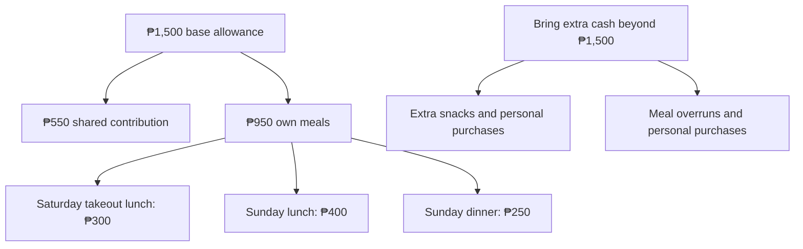
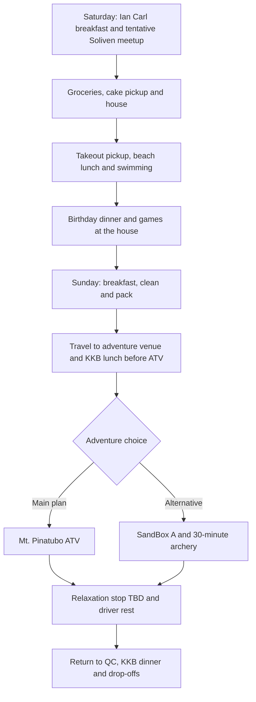

# Birthday Trip · November 7-8, 2026

**Zambales · Beach Saturday · Adventure Sunday**

A joint birthday celebration for **MC, Richelle and Paul**, with an overnight stay at Barte’s grandfather’s house in **San Antonio, Zambales**.

[Download the printable PDF](Birthday-Trip-Plan.pdf) · [PNG overview](assets/trip-overview.png)

| Detail | Current plan |
| --- | --- |
| Dates | Saturday-Sunday, November 7-8, 2026 |
| Transport | Barte’s car; final seating and driver to be confirmed |
| Meetup | **Jollibee Soliven - tentative**; final pickup pins to follow |
| Accommodation | Family home in San Antonio |
| Saturday | Groceries, cake pickup, house stop, takeout lunch at Limliwa Beach, birthday dinner and games |
| Sunday | KKB lunch before ATV, adventure and a relaxation stop - venue pending |
| Personal budget | **₱1,500 base allowance - please bring extra cash** |
| Target home arrival | Around **11 PM Sunday**, depending on traffic |

**The itinerary is still proposed. Pending destinations and arrangements are open to group suggestions and approval.**

## Route maps

| Day | Google Maps route |
| --- | --- |
| Day 1 - Saturday, November 7 | [Open route](https://maps.app.goo.gl/bow4Z7npJpLcuBze9) |
| Day 2 - Sunday, November 8 | [Open route](https://maps.app.goo.gl/9TENoR7mgRZXrqK6A) |

Route links supplied by MC. The linked maps may still show the previous stop order. Saturday now uses **Jollibee Soliven (tentative)**, groceries, cake pickup, the house, takeout pickup and the beach. Sunday’s route depends on the ATV operator and the still-pending relaxation stop.

## Personal budget and KKB expenses

| Expense per friend | Suggested amount |
| --- | --- |
| Shared contribution toward groceries, fuel and tolls | ₱550 |
| Saturday takeout lunch at the beach | ₱300 |
| Sunday lunch outside | ₱400 |
| Sunday dinner outside | ₱250 |
| **Base allowance** | **₱1,500** |

**Please bring extra cash on top of ₱1,500.** The meal amounts are estimates, and ₱1,500 is **not a guaranteed all-in budget**. Your actual spending will depend on restaurant prices and personal orders.

Keep **₱950 for Saturday takeout lunch, Sunday lunch and Sunday dinner** and set aside **₱550 for the shared contribution**.

| Additional personal expense | Arrangement |
| --- | --- |
| Meals exceeding the allowance | Pay the difference individually |
| Extra snacks, drinks and personal purchases | Own expense |
| Optional activities outside the agreed itinerary | Confirm the cost and payment arrangement before joining |

## Attendance

**Final attendance deadline: November 2, 2026.** Please confirm by then so Barte can finalize the headcount and house arrangements. The table below shows the last recorded attendance statuses.

| Person | Status | Notes |
| --- | --- | --- |
| MC | Confirmed |  |
| Richelle | Confirmed |  |
| Karl | Confirmed |  |
| Ian Barte | Confirmed |  |
| Ian Carl | Confirmed |  |
| Paul | Pending | Expects to know around October 25 |
| Jannelle | Pending | Awaiting confirmation |
| Ian Carreon | Pending | Awaiting confirmation |
| Blessy | Conditional | Previously day trip only; permission and transport need reconfirmation |
| Barte’s father | Tentative | May drive and prepare pork adobo if joining |
| Barte’s mother | Tentative | Awaiting confirmation |

**Current working headcount: seven**, including Barte’s parents if they join. Vehicle seating and sleeping arrangements must be reviewed if more people confirm.

## Saturday · November 7

**Beach, birthday dinner and games at the house**

| Time | Plan |
| --- | --- |
| 5:30&#8209;6&nbsp;AM | MC arrives at Barte’s house, parks his motorcycle and helps load the car. |
| 6&#8209;7&nbsp;AM | Pickups and meetup at **Jollibee Soliven - tentative**. Final pickup arrangements to follow. **Ian Carl prepares and packs Saturday’s light breakfast.** |
| 7&#8209;11&nbsp;AM | Travel to Zambales. Allow approximately **four hours**, including a short stop if needed. |
| 11&nbsp;AM&#8209;12&nbsp;NN | Shop at **San Marcelino Public Market** and a grocery for dinner and Sunday breakfast ingredients, fruit, drinks, water and ice. Karl identifies Sunday breakfast ingredients. Keep chilled purchases in the iced cooler. |
| 12&#8209;12:30&nbsp;PM | **Cake pickup after groceries: KDB Sweet Shop**, Money Tree Building, Brgy. Rizal, San Antonio, behind 7-Eleven. **Preorder, flavor/design and pickup time still need confirmation.** |
| 12:30&#8209;1&nbsp;PM | House stop: refrigerate raw meat and breakfast ingredients, store the cake, and prepare beach bags and a clean drinks cooler. Driver rests while others organize. |
| 1&#8209;2&nbsp;PM | Leave the house, **collect freshly prepared takeout lunch - KKB**, then travel to **Limliwa Beach Resort**. Choose a shop near the house or along the beach route; confirm ordering/pickup ahead. |
| 2&#8209;2:30&nbsp;PM | **Eat takeout lunch at the beach cottage.** Keep the **₱300 personal allowance**. Cottage access is walk-in and subject to availability. |
| 2:30&#8209;5:30&nbsp;PM | Beach swimming, photos, games and group hangout. |
| 5:30&#8209;6&nbsp;PM | Leave the resort and return to the house. |
| 6&#8209;8&nbsp;PM | Shower, prepare **pork BBQ, pork adobo and rice**, eat together and celebrate with birthday cake. |
| 8&#8209;10&nbsp;PM | Birthday games, music, group photos and bonding **at the house**. |
| 10&#8209;11:30&nbsp;PM | UNO, cards, snacks and a relaxed hangout. Volunteers can bring small games. |
| 11:30&nbsp;PM&nbsp;onward | Rest or quiet bonding. No fixed group bedtime, but the driver needs sufficient sleep before Sunday’s trip. |

### Saturday takeout shortlist - KKB

| Option | Published meal prices | Plan |
| --- | --- | --- |
| **Wideplate Restaurant** | Owner-uploaded menu reproduced by Restaurant Guru: lumpia silog ₱165, sisig with rice / liempo silog ₱185, chicken silog ₱190, tapsilog ₱225 | Takeout candidate; confirm service, current prices and pickup time |
| **LML Sports Restaurant** | Own online catalog: regular silog meals ₱90-95; selected upsized meals ₱150 | Lower-cost takeout candidate; confirm service, current prices and pickup time |

Takeout shortlist references checked October 24, 2026: [Wideplate Facebook](https://www.facebook.com/wideplaterestaurant/) · [Owner-uploaded Wideplate menu reproduced by Restaurant Guru](https://restaurantguru.com/Wildeplate-Restaurant-San-Antonio-Central-Luzon/menu) · [LML own online catalog](https://lmlsportsrestaurant.catalog.kyte.site/silogs-and-sizzlings). These are options to check, not a selected restaurant. Confirm takeout service, current prices and pickup time. Keep the ₱300 personal allowance.

### Limliwa Beach reminders

**Day tour: 6 AM-6 PM only.** Walk-ins are first come, first served. **Tent pitching is prohibited**, loud speakers are discouraged, and cooking/grilling is allowed only in the common cooking area.

Dinner is planned **at the house**. Bring only what is needed for the beach.

### Beach lunch and cooler flow

**Saturday lunch plan: KKB takeout at Limliwa after the house stop.** Buy lunch shortly before reaching the beach, after refrigerating the meat and storing the cake. Limliwa confirmed outside food and drinks are allowed, with no corkage fee. Lunch is around **2 PM**; bring a small snack for the drive.

| Stage | Plan |
| --- | --- |
| QC and grocery stop | Keep marinated BBQ and other chilled ingredients in sealed, leakproof containers in an iced cooler. |
| At the house | Transfer raw meat and chilled breakfast ingredients into the refrigerator/freezer promptly. |
| Beach preparation | Prefer a separate clean cooler for drinks and chilled snacks. If reusing the meat cooler, discard old ice, wash and sanitize it, then add fresh ice. Keep chips in a dry bag. |
| Takeout and beach lunch | After the house stop, collect takeout shortly before arriving at the beach and eat on arrival. Limliwa confirmed outside food and drinks are allowed with no corkage fee. |

Outside-food policy confirmed directly by Limliwa in a message shared by MC on October 23, 2026: food and drinks are allowed, with no corkage fee.

## Sunday · November 8

**ATV adventure and a relaxed stop before heading home**

This schedule assumes an ATV provider around **Capas/Santa Juliana**. Travel times and the afternoon schedule will be adjusted once the operator and meeting point are confirmed.

| Time | Plan |
| --- | --- |
| 7:30&#8209;9&nbsp;AM | Breakfast, cleanup and packing. **Karl plans the menu and ingredients; Karl and MC cook.** Everyone helps clean and loads all belongings into the car. |
| 9&nbsp;AM&#8209;12&nbsp;NN | Travel directly to the **ATV meeting point**. Allow approximately **three hours** for now; the exact operator and location still need confirmation. |
| 12&#8209;1&nbsp;PM | **Lunch outside - KKB, before ATV.** Eat near the confirmed adventure meeting point. Venue pending; **₱400 personal allowance**. |
| 1&#8209;2:30&nbsp;PM | **Mt. Pinatubo lahar-trail ATV adventure.** Allow for registration, briefing and the preferred **30-minute to one-hour ride**. Operator and booking pending. |
| 2:30&#8209;3&nbsp;PM | Freshen up and transfer to the **relaxation stop - venue pending**. Route and travel time depend on the confirmed ATV operator. |
| 3&#8209;5&nbsp;PM | **Relaxation and driver rest - destination undecided.** Walk, take photos and spend time together somewhere along the return route. New Clark City River Park is only a candidate; group suggestions welcome. |
| 5&#8209;5:30&nbsp;PM | Restroom stop, organize belongings and prepare for departure. |
| 5:30&#8209;9:30&nbsp;PM | Travel back to QC, allowing approximately **four hours** with a rest stop if needed. |
| 9:30&#8209;10:15&nbsp;PM | **Dinner outside - KKB.** Restaurant to be decided in QC or along the return route. |
| 10:15&#8209;11&nbsp;PM | Passenger drop-offs and MC’s motorcycle pickup at Barte’s house. |
| Around&nbsp;11&nbsp;PM | Target arrival home, depending on traffic and drop-off locations. |

**There is no planned return to the San Antonio house on Sunday.** Pack everything and clean the house before leaving in the morning.

### Sunday activity choices

| Priority | Activity | Status |
| --- | --- | --- |
| **Main adventure** | **Mt. Pinatubo lahar-trail ATV** | Operator, current package, meeting point and booking pending |
| **Alternative to ATV** | **SandBox Package A + 30-minute unlimited-arrow archery** | Subject to group approval and availability |
| Relaxation after ATV | **Venue pending** | Choose a restful stop along the route. New Clark City River Park remains one candidate; bike rental is unverified. |

**Relaxation destination is still pending.** New Clark City River Park is one candidate for riverside walking, photos and greenery. Its official site confirms bikeways, but a current bike-rental operator, price and November 8 availability have not been verified. Choose the stop after the ATV venue is confirmed.

Candidate reference: [Official New Clark City facilities](https://newclarkcity.ph/facilities/). Bike rental remains unconfirmed.

**SandBox replaces ATV if selected.** It is not an additional scheduled activity, and choosing it will require changes to the route and times.

Suggestions for a replacement adventure or relaxation stop are welcome. Choose places that fit the route and leave enough time for driver rest and the trip home.

## Shared checklists

**☑ Already available · ☐ Still to buy, borrow, assign or prepare.** Available items still need to be packed. Update and save the checkbox symbols as progress changes.

### Shared supplies

| Available - MC | Still to arrange |
| --- | --- |
| ☑ One bottle of soft drink | ☐ Main cooler - MC to borrow |
| ☑ Picnic mat | ☐ Additional cooler - Paul, if joining |
| ☑ First-aid kit | ☐ Shared sunscreen - volunteer |
| ☑ Paper plates | ☐ One lighter - volunteer |
| ☑ Spoons and forks | ☐ Dishwashing liquid, 200-250 mL - volunteer |
| ☑ Cups | ☐ Dishwashing sponges, 1-2 - volunteer |
| ☑ Trash bags | ☐ UNO, playing cards or mini Jenga - volunteers |
| ☑ Tissue/paper towels |  |
| ☑ Aluminum foil | ☐ Shuttlecocks - volunteer needed |
| ☑ Food-safe containers with lids |  |
| ☑ Clean kitchen/microfiber cloths |  |

### Anne, Karl and Ian Carl

**Ian Carl prepares Saturday’s light breakfast.** Anne brings her assigned gear. Karl plans Sunday breakfast, and **Karl and MC cook**. The boxes track preparation and packing.

| Anne | Karl |
| --- | --- |
| ☐ Pack camera gimbal | ☐ Finalize Sunday breakfast menu |
| ☐ Pack phone gimbal | ☐ List ingredients and quantities needed |
| ☐ Pack picnic mat | ☐ Coordinate breakfast ingredient purchases |
| ☐ Confirm volleyball to bring - tentative | ☐ Pack speaker |
|  | ☐ Tent, only if useful at a permitted location |

**Ian Carl:** ☐ Arrange Saturday light breakfast ingredients; ☐ prepare and pack breakfast; ☐ pack badminton rackets. **Ian Carl also handles dishwashing.**

**Limliwa prohibits tent pitching and discourages loud speakers.**

### Shared shopping

Quantities are provisional for **7-8 people**, adjusted after the **November 2 attendance deadline**. We buy our own rice, oil, sauces and seasonings. **Ian Carl handles Saturday breakfast separately; Karl finalizes Sunday breakfast.** **Buyers needed for the QC seasonings and iced tea; volunteer in the group chat before buying to avoid duplicates.**

| Buy in QC | Buy in Zambales |
| --- | --- |
| ☐ **30 marinated pork BBQ sticks** - MC to buy | ☐ Pork for adobo, approximately **1-1.5 kg** |
| ☐ **4 sharing bags of chips**, around 100-150 g each - MC to buy | ☐ Rice, approximately **2 kg uncooked** |
| ☐ **1 biscuit/cracker multipack**, with 8-10 individual packs - MC to buy | ☐ Eggs, **10-14**, subject to Karl’s menu |
| ☐ **1 pack of Mentos** - MC to buy | ☐ Hotdogs **or** longganisa, **750 g-1 kg**, subject to Karl’s menu |
| ☐ Cooking oil - buyer needed | ☐ Bananas, **10-14 pieces** |
| ☐ Soy sauce - buyer needed | ☐ **1 small watermelon** |
| ☐ Vinegar - buyer needed | ☐ **1 birthday cake from KDB Sweet Shop** - preorder and pickup after groceries; flavor/design pending |
| ☐ Salt and pepper (whole peppercorns for adobo) - buyer needed | ☐ Drinking water, initially **20 litres** |
| ☐ Garlic and onions - buyer needed | ☐ Ice for the cooler/s |
| ☐ Calamansi - buyer needed | ☐ Charcoal |
| ☐ Iced tea sachets - buyer needed | ☐ **1 additional soft drink**, only if needed |
| ☐ Dried bay leaves / laurel, 1 small pack - buyer needed |  |
| ☐ Banana ketchup, 1 small pouch - only if BBQ basting sauce is not included; buyer needed |  |
| ☐ Brown sugar, small pack - optional, confirm with cook; buyer needed |  |

Market backup: **Mc Mar Frozen Foods** and **Rodriguez Supermart, Agpalo Street**. Stock, prices, water and ice availability need confirmation. **KDB Sweet Shop cake preorder and pickup time are still pending.**

**Saturday flow:** San Marcelino market / grocery → water / ice → **KDB cake pickup** → house / refrigerator → **fresh takeout pickup** → **lunch at Limliwa Beach**. Shopping and pickup times are provisional. Confirm the cake order and takeout arrangement ahead.

Shopping references: [Mc Mar Frozen Foods listing](https://www.bizippines.com/mc-mar-frozen-foods-0929-565-7091) · [Rodriguez Supermart listing](https://www.cybo.com/PH-biz/rodriguez-supermart). These are store listings, not live inventory.

### Dinner and cooking volunteers

| Dish / task | Assignment |
| --- | --- |
| Pork BBQ | ☐ **At least two grilling volunteers needed** |
| Pork adobo | ☐ Confirm Barte’s father as cook, if joining |
| Dinner rice | ☐ Assign a cook |
| Dishwashing | **Ian Carl** |

**Dinner menu confirmed: pork BBQ and pork adobo, with rice.** Everyone helps with food preparation and general cleanup; **Ian Carl handles dishwashing**.

Chargers, cables and charged power banks are each person’s responsibility.

## Pending decisions and volunteers

| Item | What still needs arranging |
| --- | --- |
| **Attendance and transport** | Finalize attendance by **November 2, 2026**; confirm Barte’s parents, driver, vehicle seating and pickup pins |
| **ATV - Sunday’s main activity** | Find a reliable operator and confirm the package, duration, meeting point, regular-car access and booking |
| **SandBox - ATV alternative** | Group approval for **Package A + 30-minute unlimited-arrow archery**; confirm availability and adjust the route if selected |
| **Saturday lunch - KKB** | **Takeout to eat at Limliwa after the house stop.** Select a shop along the route; confirm takeout service, current prices and pickup timing. Allow ₱300 each. Wideplate and LML are options to check. |
| **Sunday lunch - KKB** | **KKB lunch before ATV**, near the final meeting point; allow ₱400 each. Choose the restaurant after confirming the operator or SandBox alternative. |
| **Relaxation stop after ATV** | **Destination pending.** New Clark City River Park is only a candidate. Confirm final venue, route, opening and any fees. No current bike-rental operator or rate verified. Suggestions welcome. |
| **Birthday cake pickup** | **KDB Sweet Shop**, Money Tree Building, Brgy. Rizal, San Antonio, behind 7-Eleven. Finalize flavor/design, place the preorder and confirm pickup after groceries on November 7. |

## Personal packing checklist

| Category | Bring |
| --- | --- |
| **Clothes** | Swimwear, dry outfit after the beach, sleepwear, Sunday adventure outfit, spare clothes, underwear and socks |
| **Footwear** | Closed-toe shoes for adventure activities; slippers for the beach and house |
| **Beach essentials** | Towel, sunscreen, waterproof pouch and wet-clothing bag |
| **Personal care** | Toiletries, personal medication, insect repellent and hygiene essentials |
| **Electronics** | Phone, charger, cable and charged power bank |
| **Travel essentials** | ID, cash, refillable water bottle, overnight bag and small day bag |
| **Rain protection** | Compact umbrella or raincoat |
| **Optional comfort items** | Cap, light jacket, personal snacks and small pillow |

**Bring extra cash beyond the ₱1,500 base allowance**, particularly for extra snacks, personal purchases and meals that exceed the estimates.

The designated driver should get sufficient sleep and take rest breaks. The schedule may change with weather, traffic, availability and the group’s condition.
