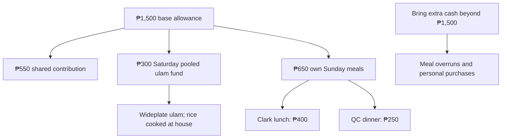
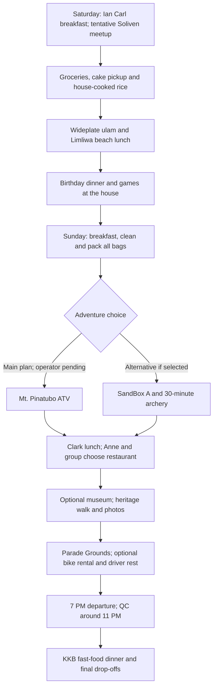

# Birthday Trip · November 7-8, 2026

**Zambales · Beach Saturday · Adventure Sunday**

A joint birthday celebration for **MC, Richelle and Paul**, with an overnight stay at Barte’s grandfather’s house in **San Antonio, Zambales**.

[Download the printable PDF](Birthday-Trip-Plan.pdf) · [PNG overview](assets/trip-overview.png)

| Detail | Current plan |
| --- | --- |
| Dates | Saturday-Sunday, November 7-8, 2026 |
| Transport | Barte’s car; final seating and driver to be confirmed |
| Meetup | **Jollibee Soliven - tentative**; final pickup pins to follow |
| Accommodation | Family home in San Antonio |
| Saturday | Groceries, cake pickup, house stop, takeout lunch at Limliwa Beach, birthday dinner and games |
| Sunday | ATV first, then lunch and a relaxed afternoon around Clark Parade Grounds |
| Personal budget | **₱1,500 base allowance - please bring extra cash** |
| Sunday return | Leave Clark at **7 PM**; QC around **11 PM**, then dinner and drop-offs |

**The itinerary is still proposed. Pending destinations and arrangements are open to group suggestions and approval.**

## Route maps

| Day | Google Maps route |
| --- | --- |
| Day 1 - Saturday, November 7 | [Open route](https://maps.app.goo.gl/bow4Z7npJpLcuBze9) |
| Day 2 - Sunday, November 8 | [Open route](https://maps.app.goo.gl/9TENoR7mgRZXrqK6A) |

Route links supplied by MC. **The linked maps may still show the previous stop order.** Saturday now uses Jollibee Soliven (tentative), groceries, cake pickup, the house to cook rice, Wideplate takeout pickup and Limliwa. Sunday now runs **San Antonio → ATV meeting point (pending) → Clark Parade Grounds and nearby lunch → QC**. Update the driving route once the ATV operator is confirmed.

## Personal budget and KKB expenses

| Expense per friend | Suggested amount |
| --- | --- |
| Shared contribution toward groceries, fuel and tolls | ₱550 |
| Saturday shared ulam fund - Wideplate takeout | ₱300 |
| Sunday lunch near Clark Parade Grounds - KKB | ₱400 |
| Sunday fast-food dinner in QC - KKB | ₱250 |
| **Base allowance** | **₱1,500** |

**Please bring extra cash on top of ₱1,500.** The meal amounts are estimates, and ₱1,500 is **not a guaranteed all-in budget**. Your actual spending will depend on restaurant prices and personal orders.

Set aside **₱550 for the shared contribution** and **₱300 for Saturday’s pooled Wideplate ulam fund**. Keep **₱650 for your own Sunday meals**: ₱400 for lunch and ₱250 for dinner. Saturday lunch rice is cooked at the house. Any unused ulam fund may go toward fuel or tolls **with the group’s agreement**.

| Additional personal expense | Arrangement |
| --- | --- |
| Meals exceeding the allowance | Pay the difference individually |
| Extra snacks, drinks and personal purchases | Own expense |
| Optional activities outside the agreed itinerary | Confirm the cost and payment arrangement before joining |

## Attendance

**Final attendance deadline: November 2, 2026.** Please confirm by then so Barte can finalize the headcount and house arrangements. The table below shows the last recorded attendance statuses.

| Person | Status | Notes |
| --- | --- | --- |
| MC | Confirmed |  |
| Richelle | Confirmed |  |
| Karl | Confirmed |  |
| Ian Barte | Confirmed |  |
| Ian Carl | Confirmed |  |
| Paul | Pending | Expects to know around October 25 |
| Jannelle | Pending | Awaiting confirmation |
| Ian Carreon | Pending | Awaiting confirmation |
| Blessy | Conditional | Previously day trip only; permission and transport need reconfirmation |
| Barte’s father | Tentative | May drive and prepare pork adobo if joining |
| Barte’s mother | Tentative | Awaiting confirmation |

**Current working headcount: seven**, including Barte’s parents if they join. Vehicle seating and sleeping arrangements must be reviewed if more people confirm.

## Saturday · November 7

**Beach, birthday dinner and games at the house**

| Time | Plan |
| --- | --- |
| 5:30&#8209;6&nbsp;AM | MC arrives at Barte’s house, parks his motorcycle and helps load the car. |
| 6&#8209;7&nbsp;AM | Pickups and meetup at **Jollibee Soliven - tentative**. Final pickup arrangements to follow. **Ian Carl prepares and packs Saturday’s light breakfast.** |
| 7&#8209;11&nbsp;AM | Travel to Zambales. Allow approximately **four hours**, including a short stop if needed. |
| 11&nbsp;AM&#8209;12&nbsp;NN | Shop at **San Marcelino Public Market** and a grocery for dinner and Sunday breakfast ingredients, fruit, drinks, water and ice. Karl identifies Sunday breakfast ingredients. Keep chilled purchases in the iced cooler. |
| 12&#8209;12:30&nbsp;PM | **Cake pickup after groceries: KDB Sweet Shop**, Money Tree Building, Brgy. Rizal, San Antonio, behind 7-Eleven. **Preorder, flavor/design and pickup time still need confirmation.** |
| 12:30&#8209;1:15&nbsp;PM | House stop: **cook rice for the shared beach lunch**, refrigerate raw meat and breakfast ingredients, store the cake, and prepare beach bags and a clean drinks cooler. Driver rests while others organize. |
| 1:15&#8209;2&nbsp;PM | Collect **Wideplate ulam takeout**, then travel to **Limliwa Beach Resort**. Choose dishes together on arrival using the **₱300-per-person pooled ulam fund**. Bring cooked rice from the house. Allow extra time if orders take longer. |
| 2&#8209;2:30&nbsp;PM | **Shared lunch at the beach cottage:** Wideplate ulam and rice cooked at the house. Choose quantities based on the final headcount. Cottage access is walk-in and subject to availability. |
| 2:30&#8209;5:30&nbsp;PM | Beach swimming, photos, games and group hangout. |
| 5:30&#8209;6&nbsp;PM | Leave the resort and return to the house. |
| 6&#8209;8&nbsp;PM | Shower, prepare **pork BBQ, pork adobo and rice**, eat together and celebrate with birthday cake. |
| 8&#8209;10&nbsp;PM | Birthday games, music, group photos and bonding **at the house**. |
| 10&#8209;11:30&nbsp;PM | UNO, cards, snacks and a relaxed hangout. Volunteers can bring small games. |
| 11:30&nbsp;PM&nbsp;onward | Rest or quiet bonding. No fixed group bedtime, but the driver needs sufficient sleep before Sunday’s trip. |

### Saturday shared lunch - Wideplate

| Saturday lunch | Arrangement | What remains |
| --- | --- | --- |
| **Wideplate Restaurant** | **₱300 per person pooled for shared ulam**. Cook rice at the house and bring it to the beach. | Choose dishes and quantities spontaneously on arrival; confirm takeout service and ordering time. |

Selected Saturday lunch source: [Wideplate Restaurant Facebook](https://www.facebook.com/wideplaterestaurant/). The group will choose shared dishes on arrival using the final headcount. **Rice comes from the house.** Any unused ulam fund may be redirected to fuel or tolls with the group’s agreement.

### Limliwa Beach reminders

**Day tour: 6 AM-6 PM only.** Walk-ins are first come, first served. **Tent pitching is prohibited**, loud speakers are discouraged, and cooking/grilling is allowed only in the common cooking area.

Dinner is planned **at the house**. Bring only what is needed for the beach.

### Beach lunch and cooler flow

**Saturday lunch: Wideplate ulam takeout and house-cooked rice at Limliwa.** Pool ₱300 per person for ulam and decide the dishes together at the restaurant. Five people provide ₱1,500; the fund scales with attendance. Cook rice during the house stop and collect freshly prepared ulam afterward. Limliwa confirmed outside food and drinks are allowed, with no corkage fee. Lunch is around 2 PM; bring a small snack for the drive.

| Stage | Plan |
| --- | --- |
| QC and grocery stop | Keep marinated BBQ and other chilled ingredients in sealed, leakproof containers in an iced cooler. |
| At the house | Transfer raw meat and chilled breakfast ingredients into the refrigerator/freezer promptly. |
| Beach preparation | Prefer a separate clean cooler for drinks and chilled snacks. If reusing the meat cooler, discard old ice, wash and sanitize it, then add fresh ice. Keep chips in a dry bag. |
| Takeout and beach lunch | After the house stop, collect takeout shortly before arriving at the beach and eat on arrival. Limliwa confirmed outside food and drinks are allowed with no corkage fee. |

Outside-food policy confirmed directly by Limliwa in a message shared by MC on October 23, 2026: food and drinks are allowed, with no corkage fee.

## Sunday · November 8

**ATV first, then lunch and a relaxed afternoon around Clark Parade Grounds**

**Sunday’s plan is ATV first, then lunch and the afternoon around Clark Parade Grounds.** Times assume a Capas/Santa Juliana operator and remain provisional until the meeting point and booking are confirmed. The driver must have enough rest. **A 7 PM Clark departure means QC around 11 PM before dinner and final drop-offs.**

| Time | Plan |
| --- | --- |
| 6&#8209;7&nbsp;AM | Breakfast. **Karl plans the menu and ingredients; Karl and MC cook.** Everyone eats and gets ready. |
| 7&#8209;7:30&nbsp;AM | Clean the house, pack and load **all belongings**. Bring the day bag, water and a change of clothes for ATV. |
| 7:30&#8209;10:30&nbsp;AM | Travel to the **Capas/Santa Juliana ATV meeting point**. Allow approximately three hours provisionally; exact operator, route and arrival time remain pending. |
| 10:30&#8209;11&nbsp;AM | Registration, safety briefing and preparation. Bring a small snack if needed before the later lunch. |
| 11&nbsp;AM&#8209;12&nbsp;NN | **Mt. Pinatubo lahar-trail ATV adventure.** Target a **30-minute to one-hour ride**. Operator, price, meeting point and booking are **pending**. |
| 12&#8209;12:30&nbsp;PM | Freshen up, change clothes and prepare for the Clark transfer. |
| 12:30&#8209;1:30&nbsp;PM | Travel to **Clark Parade Grounds**. This one-hour allowance must be checked against the final ATV meeting point. |
| 1:30&#8209;2:30&nbsp;PM | **Lunch around Clark Parade Grounds - KKB, ₱400 each.** **Anne and the group choose the restaurant.** Options: Barn by Conti’s, Couscousi Mediterranean Grill and Porch Coffee. |
| 2:30&#8209;3:45&nbsp;PM | **Optional Clark Museum.** Visit before the published 4 PM closing. Admission and student exemption need confirmation; the 4D theater is separate and not scheduled. |
| 3:45&#8209;4:30&nbsp;PM | Walk along the **historic Barn Houses** and visit the nearby **Fort Stotsenburg gateposts and memorials** for photos. |
| 4:30&#8209;6:30&nbsp;PM | Relax at **Parade Grounds**: walking, photos, picnic-mat hangout and cards/UNO. **Optional bicycle rental costs extra**; current rates and availability need checking. Driver rests. |
| 6:30&#8209;7&nbsp;PM | Restroom stop, organize belongings and prepare to leave. |
| 7&#8209;11&nbsp;PM | Travel back to QC. Allow approximately **four hours**, including a rest stop if needed. |
| Around&nbsp;11&nbsp;PM&nbsp;onward | **Fast-food dinner in QC - KKB, ₱250 allowance.** Choose McDonald’s, Jollibee or another convenient option on arrival, then complete drop-offs and MC’s motorcycle pickup. Home arrival may be after 11 PM. |

**There is no planned return to the San Antonio house on Sunday.** Pack everything and clean the house before leaving in the morning.

### Sunday activity choices

| Priority | Activity | Status |
| --- | --- | --- |
| **Main adventure** | **Mt. Pinatubo lahar-trail ATV** | Operator, current package, meeting point and booking pending |
| **Alternative to ATV** | **SandBox Package A + 30-minute unlimited-arrow archery** | Replaces ATV only if selected; approval and availability pending |
| **After ATV** | **Clark Parade Grounds and nearby stops** | Selected afternoon area; lunch restaurant chosen by Anne and the group |
| Optional indoor stop | **Clark Museum** | Current admission, student exemption and Sunday access need confirmation |
| Optional rental | **Bicycle rental near Parade Grounds** | Personal extra; operator, rates and availability need checking |

### Sunday lunch choices - Anne and group decide

| Restaurant | Published examples | Budget note |
| --- | --- | --- |
| Barn by Conti’s | Soy-egg arroz caldo ₱330; crispy-pork arroz caldo ₱400; pesto linguine ₱400 | Selected dishes fit ₱400; most meat-and-rice mains cost more. |
| Couscousi Mediterranean Grill | Falafel wrap ₱360 | Vegetarian wrap fits; most meat dishes exceed ₱400. |
| Porch Coffee | Breakfast rice meals start at ₱400 | Uses the full allowance before drinks or possible charges. |

**Anne and the group will choose the restaurant.** Keep ₱400 each for Sunday lunch and bring extra. Barn and Couscousi figures are listed delivery-menu prices; dine-in prices and service charges may differ. Porch’s starting price is from a May 2026 feature. The whole menu is not necessarily within budget.

Menu links: [Barn by Conti’s - Clark](https://www.foodpanda.ph/restaurant/zwbg/barn-by-contis-clark-freeport-zone) · [Couscousi - Clark Parade Grounds](https://www.foodpanda.ph/restaurant/kmbo/couscousi-mediterranean-grill-clark-parade-grounds) · [Porch Coffee](https://www.instagram.com/porchcoffeeph/) · [Porch May 2026 food-price reference](https://www.topgear.com.ph/features/feature-articles/coffee-run-porch-coffee-clark-a4682-20260522).

### Around Parade Grounds

| Nearby stop | What we can do |
| --- | --- |
| Clark Museum - optional | Indoor exhibits before the published 4 PM closing. Student admission and current fees need confirmation. |
| Historic Barn Houses | Walk along R.C. Santos, take photos and browse cafés. Purchases are optional. |
| Fort Stotsenburg gateposts and memorials | Short heritage and photo stops around the grounds. |
| Parade Grounds | Walking, photos, picnic-mat hangout, cards/UNO and driver rest. |
| Bicycle rental - optional | Choose only if interested. Rental is a personal extra; current rates and availability are not confirmed. |

**The afternoon area is now Clark Parade Grounds.** Park and explore the nearby museum, Barn Houses, Fort Stotsenburg gateposts and memorials on foot, then relax at the grounds. Bike rental is optional and costs extra. **Free student museum admission is not yet confirmed**; bring a valid student ID. A March 2026 guide lists museum admission at ₱100 and the 4D theater separately at ₱100, with Tuesday-Sunday hours of 9 AM-4 PM. These are reference rates, not a confirmed November 8 quote. The theater is not part of the scheduled plan.

References checked October 24, 2026: [Clark Museum Facebook](https://www.facebook.com/clarkmuseum/) · [Visit Clark](https://www.facebook.com/visitclark/) · [March 2026 Clark guide: museum fees and hours](https://www.spot.ph/things-to-do/weekend-guides/spot-out-of-town-discover-the-best-things-to-do-in-clark-pampanga-a5138-20260326-dyn) · [Nearby heritage walking stops](https://mobility.inquirer.net/2020/10/11/columns/day-tripper/day-tripper-bike-bite-ride-in-clark/) · [Bike My Way rental page](https://www.facebook.com/bikemywayph/). Confirm current museum policies and rental details before the trip.

**SandBox replaces ATV if selected.** It is not an additional scheduled activity, and choosing it will require changes to the route and times.

Suggestions are welcome for the pending ATV operator or restaurant choice. Keep the afternoon around Parade Grounds so the group can walk, take photos and rest before the 7 PM departure.

## Shared checklists

**☑ Already available · ☐ Still to buy, borrow, assign or prepare.** Available items still need to be packed. Update and save the checkbox symbols as progress changes.

### Shared supplies

| Available - MC | Still to arrange |
| --- | --- |
| ☑ One bottle of soft drink | ☐ Main cooler - MC to borrow |
| ☑ Picnic mat | ☐ Additional cooler - Paul, if joining |
| ☑ First-aid kit | ☐ Shared sunscreen - volunteer |
| ☑ Paper plates | ☐ One lighter - volunteer |
| ☑ Spoons and forks | ☐ Dishwashing liquid, 200-250 mL - volunteer |
| ☑ Cups | ☐ Dishwashing sponges, 1-2 - volunteer |
| ☑ Trash bags | ☐ UNO, playing cards or mini Jenga - volunteers |
| ☑ Tissue/paper towels |  |
| ☑ Aluminum foil | ☐ Shuttlecocks - volunteer needed |
| ☑ Food-safe containers with lids |  |
| ☑ Clean kitchen/microfiber cloths |  |

### Anne, Karl and Ian Carl

**Ian Carl prepares Saturday’s light breakfast.** Anne brings her assigned gear. Karl plans Sunday breakfast, and **Karl and MC cook**. The boxes track preparation and packing.

| Anne | Karl |
| --- | --- |
| ☐ Pack camera gimbal | ☐ Finalize Sunday breakfast menu |
| ☐ Pack phone gimbal | ☐ List ingredients and quantities needed |
| ☐ Pack picnic mat | ☐ Coordinate breakfast ingredient purchases |
| ☐ Confirm volleyball to bring - tentative | ☐ Pack speaker |
|  | ☐ Tent, only if useful at a permitted location |

**Ian Carl:** ☐ Arrange Saturday light breakfast ingredients; ☐ prepare and pack breakfast; ☐ pack badminton rackets. **Ian Carl also handles dishwashing.**

**Limliwa prohibits tent pitching and discourages loud speakers.**

### Shared shopping

Quantities are provisional for **7-8 people**, adjusted after the **November 2 attendance deadline**. We buy our own rice, oil, sauces and seasonings. **Ian Carl handles Saturday breakfast separately; Karl finalizes Sunday breakfast.** **Buyers needed for the QC seasonings and iced tea; volunteer in the group chat before buying to avoid duplicates.**

| Buy in QC | Buy in Zambales |
| --- | --- |
| ☐ **30 marinated pork BBQ sticks** - MC to buy | ☐ Pork for adobo, approximately **1-1.5 kg** |
| ☐ **4 sharing bags of chips**, around 100-150 g each - MC to buy | ☐ Rice, initially **2 kg uncooked** - recheck after headcount; covers Saturday lunch, dinner and Sunday breakfast |
| ☐ **1 biscuit/cracker multipack**, with 8-10 individual packs - MC to buy | ☐ Eggs, **10-14**, subject to Karl’s menu |
| ☐ **1 pack of Mentos** - MC to buy | ☐ Hotdogs **or** longganisa, **750 g-1 kg**, subject to Karl’s menu |
| ☐ Cooking oil - buyer needed | ☐ Bananas, **10-14 pieces** |
| ☐ Soy sauce - buyer needed | ☐ **1 small watermelon** |
| ☐ Vinegar - buyer needed | ☐ **1 birthday cake from KDB Sweet Shop** - preorder and pickup after groceries; flavor/design pending |
| ☐ Salt and pepper (whole peppercorns for adobo) - buyer needed | ☐ Drinking water, initially **20 litres** |
| ☐ Garlic and onions - buyer needed | ☐ Ice for the cooler/s |
| ☐ Calamansi - buyer needed | ☐ Charcoal |
| ☐ Iced tea sachets - buyer needed | ☐ **1 additional soft drink**, only if needed |
| ☐ Dried bay leaves / laurel, 1 small pack - buyer needed |  |
| ☐ Banana ketchup, 1 small pouch - only if BBQ basting sauce is not included; buyer needed |  |
| ☐ Brown sugar, small pack - optional, confirm with cook; buyer needed |  |

Market backup: **Mc Mar Frozen Foods** and **Rodriguez Supermart, Agpalo Street**. Stock, prices, water and ice availability need confirmation. **KDB Sweet Shop cake preorder and pickup time are still pending.**

**Saturday flow:** San Marcelino market / grocery → water / ice → **KDB cake pickup** → house / refrigerator / **cook lunch rice** → **Wideplate ulam takeout pickup** → **shared lunch at Limliwa Beach**. Shopping, cooking and pickup times are provisional.

Shopping references: [Mc Mar Frozen Foods listing](https://www.bizippines.com/mc-mar-frozen-foods-0929-565-7091) · [Rodriguez Supermart listing](https://www.cybo.com/PH-biz/rodriguez-supermart). These are store listings, not live inventory.

### Dinner and cooking volunteers

| Dish / task | Assignment |
| --- | --- |
| Pork BBQ | ☐ **At least two grilling volunteers needed** |
| Pork adobo | ☐ Confirm Barte’s father as cook, if joining |
| Lunch and dinner rice | ☐ Assign a cook; prepare Saturday lunch rice during the house stop |
| Dishwashing | **Ian Carl** |

**Dinner menu confirmed: pork BBQ and pork adobo, with rice.** Everyone helps with food preparation and general cleanup; **Ian Carl handles dishwashing**.

Chargers, cables and charged power banks are each person’s responsibility.

## Pending decisions and volunteers

| Item | What still needs arranging |
| --- | --- |
| **Attendance and transport** | Finalize attendance by **November 2, 2026**; confirm Barte’s parents, driver, vehicle seating and pickup pins |
| **ATV - Sunday’s main activity** | Find a reliable operator and confirm the package, duration, meeting point, regular-car access and booking |
| **SandBox - ATV alternative** | Group approval for **Package A + 30-minute unlimited-arrow archery**; confirm availability and adjust the route if selected |
| **Saturday shared lunch - Wideplate** | Pool **₱300 per person for ulam**, bring rice cooked at the house, choose orders together on arrival and check pickup timing. |
| **Sunday lunch - KKB** | **Anne and the group choose a restaurant near Clark Parade Grounds.** Allow ₱400 each; shortlist: Barn by Conti’s, Couscousi Mediterranean Grill and Porch Coffee. Check dine-in menus and charges. |
| **Clark afternoon details** | Parade Grounds is the selected area. Confirm museum Sunday hours, current admission and student exemption; check optional bicycle rental prices and availability. |
| **Birthday cake pickup** | **KDB Sweet Shop**, Money Tree Building, Brgy. Rizal, San Antonio, behind 7-Eleven. Finalize flavor/design, place the preorder and confirm pickup after groceries on November 7. |

## Personal packing checklist

| Category | Bring |
| --- | --- |
| **Clothes** | Swimwear, dry outfit after the beach, sleepwear, Sunday adventure outfit, spare clothes, underwear and socks |
| **Footwear** | Closed-toe shoes for adventure activities; slippers for the beach and house |
| **Beach essentials** | Towel, sunscreen, waterproof pouch and wet-clothing bag |
| **Personal care** | Toiletries, personal medication, insect repellent and hygiene essentials |
| **Electronics** | Phone, charger, cable and charged power bank |
| **Travel essentials** | ID, cash, refillable water bottle, overnight bag and small day bag |
| **Rain protection** | Compact umbrella or raincoat |
| **Optional comfort items** | Cap, light jacket, personal snacks and small pillow |

**Bring extra cash beyond the ₱1,500 base allowance**, particularly for extra snacks, personal purchases and meals that exceed the estimates.

The designated driver should get sufficient sleep and take rest breaks. The schedule may change with weather, traffic, availability and the group’s condition.
