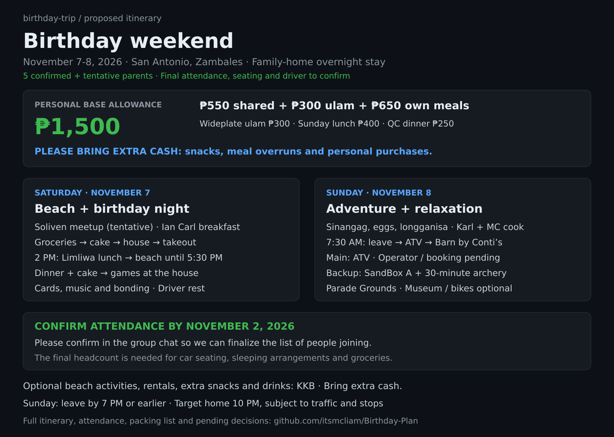
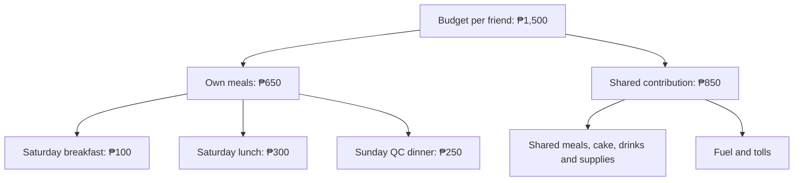
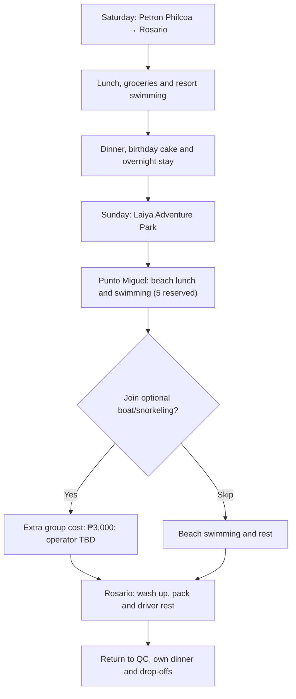

# Birthday Trip · November 7-8, 2026

**2 cars · Overnight at Barto's family home in Rosario · ₱1,500 per friend**

[Download the printable PDF](Birthday-Trip-Plan.pdf)

**Latest plan: this README includes the October 21 gear and beach-lunch updates. The PDF and PNG overview are earlier versions and do not include these updates.**

## Booking status - updated October 15, 2026

| Venue | Status | Details |
| --- | --- | --- |
| Punto Miguel Beach House | **Reserved for 5 people** | Sunday, November 8, 2026 - day tour. Booking confirmation received. |
| Laiya Adventure Park | Pending confirmation | Reservation not yet confirmed. |
| Saturday resort | Pending confirmation | Resort choice and booking still need confirmation. |

The **5 reserved slots at Punto Miguel** are separate from the attendance count below. Additional guests are subject to confirmation with the resort.

## Attendance - updated October 15, 2026

**4 confirmed | 7 pending/conditional | Up to 11 participants if everyone joins**

| Person | Status | Notes |
| --- | --- | --- |
| MC | Confirmed | |
| Richelle | Confirmed | |
| Karl | Pending | Awaiting confirmation. |
| Ian Barte | Confirmed | |
| Ian Carl | Confirmed | |
| Paul | Pending | Expects to confirm around October 25. |
| Jannelle | Pending | Awaiting confirmation. |
| Ian Carreon | Pending | Awaiting confirmation. |
| Walter | Pending | Awaiting confirmation. |
| Gerard | Pending | Awaiting confirmation. |
| Blessy | Conditional - day trip only | Parental permission and an approved driver with that driver's van still need confirmation. |

Plan around the **4 confirmed participants** for now. If all pending participants join, the maximum is **11 total**, including Blessy for the day only, and **10 overnight participants**. Confirm vehicle seating and sleeping arrangements against the final headcount; the driver/van mentioned for Blessy is a condition, not a booked transport arrangement.

The **₱1,500 budget per friend**, proposed two-car itinerary, optional boat and driver rest periods remain the current plan. Total shared costs and MC's spending still need confirmation against the final attendance and bookings.

## Budget per friend

| Expense | Budget |
| --- | --- |
| Saturday breakfast | ₱100 |
| Saturday lunch at a restaurant | ₱300 |
| Sunday dinner in QC | ₱250 |
| Contribution to groceries, fuel and tolls | ₱850 |
| **Total per friend** | **₱1,500** |

Keep **₱650** for your own meals. The **₱850 shared contribution** helps cover groceries for Saturday dinner, Sunday breakfast and beach lunch; birthday cake, basic drinks, supplies, fuel and tolls.

**MC covers** the main activities: Saturday resort, Laiya Adventure Park and Punto Miguel beach entrance/table fees. Overnight accommodation is free. Exact activity costs are not provided in the source plan.

## Trip flow

## Saturday, November 7

| Time | Plan |
| --- | --- |
| 6:00-6:30 AM | Meet at Petron Philcoa. Buy/eat your own light breakfast. |
| 6:30-9:30/10:00 AM | Travel to Rosario, with a restroom stop if needed. |
| 10:00-11:00 AM | Settle at the house. Drivers rest while everyone else organizes their belongings. |
| 11:00 AM-12:00 noon | Lunch at a restaurant; location TBD. Pay for your own meal. |
| 12:00-1:00 PM | Grocery run for shared meals, cake, drinks and supplies. |
| 1:00-1:30 PM | Drop groceries at the house, refrigerate perishables and head to the resort. |
| 1:30-5:00 PM | Resort swimming and group activities. |
| 5:00-7:30 PM | Return to the house, wash up, rest, then cook and eat dinner. |
| 7:30-10:00 PM | Birthday cake for MC, Richelle and Paul. Games and hangout time. Prepare Sunday's bags, cooler and food containers. |
| 10:00 PM onward | Sleep, especially the drivers. |

## Sunday, November 8

| Time | Plan |
| --- | --- |
| 5:30-7:00 AM | Assigned cooks prepare breakfast; pack the cooler and ingredients for beach grilling (menu and grill access pending). Everyone eats and gets ready. |
| 7:00-8:30 AM | Travel to Laiya Adventure Park. |
| 8:30-11:30 AM | Package B: zipline, giant swing, freefall, aerial walk, climbing and rappelling. |
| 11:30 AM-12:30 PM | Transfer to Punto Miguel (day tour reserved for 5), settle at our table and prepare grilled lunch (menu and grill access pending). |
| 12:30-2:30 PM | Finish lunch, then beach swimming, photos, hangout time and rest. Optional boating/snorkeling. |
| 2:30-4:30 PM | Wash up, change and travel back to the Rosario house. |
| 4:30-5:30 PM | Drivers rest or nap. Everyone else cleans and packs. |
| 5:30-8:30 PM | Travel back to QC, with a rest stop if needed. |
| 8:30-9:15 PM | Dinner in QC; decide where upon arrival. Pay for your own meal. |
| 9:15-10:00 PM | Final drop-offs and head home. |

## Shared gear and supplies - updated October 21, 2026

### Who will bring what

| Person | Items | Status / notes |
| --- | --- | --- |
| Anne | 2 gimbals: one for the camera and one for the phone; picnic mat | Assigned to bring. |
| Karl | Speaker; tent if permitted | Attendance still pending. Confirm whether the tent may be brought and set up at the intended location. |
| Paul | Cooler | Only if he joins. Arrange a backup cooler if needed. |
| MC | Picnic mat; first-aid kit | First-aid kit already purchased. |

Gear assignments do not change anyone's attendance status.

### MC's shopping list - buy in QC and bring to Batangas

- [ ] Paper plates
- [ ] Spoons and forks
- [ ] Cups
- [ ] Trash bags
- [ ] Tissue / paper towels
- [ ] Aluminum foil
- [ ] Food-safe containers with secure lids

These are planned purchases, not yet marked as bought. Food containers are for transporting ingredients and serving/storing food; "food storage" is not a separate purchase.

### Still to arrange

| Item | Next step |
| --- | --- |
| Cards, UNO or other small games | Ask the group who can bring them; no one assigned yet. |
| BBQ tongs | Check what is available at Barte's house or the resort before buying. |
| Lighter | Check whether someone already has one before buying. |
| Cooking equipment and serving trays | Ask Barte what is available and whether the group may use it; not yet confirmed. |
| Refrigerator space | Ask Barte whether there is space for the marinated meat. |
| Extension cord | Check availability at Barte's house before bringing or buying one. |
| Drinking water and ice | Buy in Batangas. |
| Grill and charcoal | Confirm grill access at Punto Miguel and what to bring before purchasing charcoal. |
| Sleeping supplies | Confirm pillows, blankets and mattresses with Barte. |

Chargers, cables and charged power banks are each person's responsibility.

### Sunday beach lunch - grilling plan, menu still tentative

The current idea is to grill at Punto Miguel. MC may buy ready-marinated BBQ in QC, transport it in a cooler with ice, refrigerate it at Barte's house, then bring it to the beach in the cooler. The menu, cooler, refrigerator space and grill access still need confirmation. Individual lunchboxes are optional; use shared serving containers for the beach meal.

## What each person should bring

| Item | Details |
| --- | --- |
| Swimwear | For both days; ideally two sets so Sunday's set is dry. |
| Saturday change of clothes | Dry outfit after resort swimming. |
| Sleepwear | For the overnight stay. |
| Sunday adventure outfit | Comfortable clothes that allow easy movement. |
| Sunday change of clothes | Dry outfit after the beach, also for dinner and the trip home. |
| Underwear and socks | Enough for both days and clothing changes, plus spares. |
| Footwear | Rubber shoes/closed-toe shoes for adventure activities; slippers/sandals for the house and beach. |
| Bath towel | For showers and drying off after swimming. |
| Toiletries | Toothbrush, toothpaste, soap/body wash, shampoo, deodorant and usual skincare. |
| Sun and insect protection | Sunscreen and insect repellent; optional cap. |
| Hygiene essentials | Tissue/wet wipes and hand sanitizer. |
| Personal medication | Any medication you normally need. |
| Lunch container | Optional personal container; shared serving containers are planned for Sunday's beach grilling. |
| Water bottle | Refillable and filled before departure. |
| Bags | Overnight bag and a small day bag for the adventure park/beach. |
| Phone and charging essentials | Phone, charger, cable and charged power bank. |
| Wallet, ID and cash | Meal allowance and extra money for personal purchases or possible transport top-ups. |
| Waterproof pouch/ziplock bag | To protect your phone and valuables. |
| Wet/dirty clothing bags | Separate bags for wet swimwear, dirty clothes and footwear. |
| Rain protection | Compact umbrella or raincoat. |
| Optional comfort items | Light jacket, personal snacks, small pillow or blanket. Sleeping arrangements still need confirmation. |

**MC plans to buy plates, spoons, forks, cups and the other shared supplies listed above in QC.**

## Optional extras and confirmations

- Boat/snorkeling: **additional ₱3,000 per group**, approximately **₱429 each if everyone joins**, as estimated in the original plan. The operator still needs to confirm the arrangement; the per-person amount changes with participant count.
- Boat and ATV costs are **outside the ₱1,500 budget**.
- This is the proposed schedule. **Punto Miguel is reserved for 5 people on November 8. Other bookings and exact resort hours still need confirmation.**
- Sleeping arrangements still need confirmation.
- Getting home by **10 PM** is the target, depending on traffic.

Prepared from the supplied Birthday Plan 2 image. Repeated Sunday rows in the image are included once. Attendance was updated from MC's confirmations on October 15, 2026. Punto Miguel's November 8 day-tour reservation for 5 was confirmed by MC on October 15, 2026. Other bookings and prices were not independently verified. Shared gear assignments, shopping plans and the tentative Sunday grilling plan were updated from MC's instructions on October 21, 2026.
